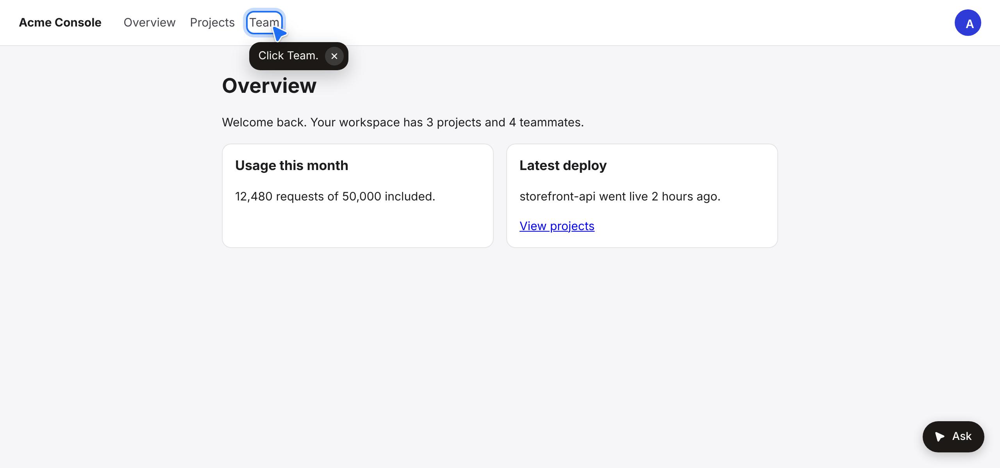

# Haptic

[](https://joinhaptic.com)
[](https://github.com/dartmouth-cs52/project-other-idea/actions/workflows/ci.yml)


**An AI guide that lives inside any web app.** A software company adds one script tag to their product. When a user asks *"how do I invite a teammate?"*, Haptic doesn't answer with a wall of help-center text. It moves a pointer to the right button, waits for the user to click it, reads the new page, and points at the next one, across menus, dialogs and full page loads, until the task is done.



**Live:** the website and dashboard at [joinhaptic.com](https://joinhaptic.com), and the widget server at `widget.joinhaptic.com`.

## Why

Help docs go stale and nobody reads them. Product tours are scripted by hand and break whenever the UI changes. Haptic reads the live page on every step, so it follows whatever the UI is today. It learns the product from what the company already has: the site itself, its help docs, and a few notes.

## What's in this repo

| Part | Path | What it is |
|---|---|---|
| **Widget** | `src/widget` | The script customers embed (about 30 KB minified, no dependencies). It renders in a shadow root so it can't clash with the host page, snapshots the page, draws the pointer and caption, and watches for the user's action. |
| **Server** | `src/server`, `worker` | One request handler (`src/server/app.ts`) that runs both as a local Node server and as a Cloudflare Worker in production. It validates input, enforces per-site spend limits, makes one streamed Claude call per step, and records each guide in Postgres (Neon). |
| **Intake** | `src/intake` | A CLI that crawls a site into a page graph, loads help docs from files, folders or URLs, and publishes the site. Companies can also add sites themselves from the dashboard. |
| **Website and dashboard** | `web` | [joinhaptic.com](https://joinhaptic.com): Next.js, Tailwind and shadcn/ui on Cloudflare. Invite-only sign-in (emailed link or Google, via Neon Auth), site setup and install health, per-site settings, and every guide with its steps. See [`web/README.md`](web/README.md). |
| **Benchmark** | `eval` | 74 frozen guide steps with known right answers, run against any model and scored for accuracy, latency and output quality. It picked the production model. See [`eval/README.md`](eval/README.md). |
| **Test app** | `testbed` | Northpine, a made-up spend-management dashboard with about 60 routes, 10,000 transactions and 179 tasks, built to contain every UI pattern known to break a pointing guide. See [`testbed/README.md`](testbed/README.md). |
| **Design system** | `DESIGN.md` | Colour, type, radii and motion shared by the widget and the website. |

## How it works

```
 site + help docs ──▶ intake / dashboard ──▶ Neon (site context)
                                                   │
 widget.js on the customer's page ── POST a turn ──▶ server ──▶ Claude
          ▲                                          │   streamed: { target: "e12", say: "Click Team.", status }
          └──────────── point, wait, observe ◀───────┘
```

### One step of a guide

1. **Snapshot.** The widget walks the DOM and lists every interactive control with a short id (`e12`), its role, label, state and where it sits (`nav`, `main › Billing`). When a dialog is open, only the dialog's controls are listed.
2. **Decide.** The server sends the snapshot, the goal and the progress so far to Claude. The reply is checked against a strict schema, and a target that isn't on the current page is dropped, so the model can only point at what the user can actually see.
3. **Point.** The reply is streamed, so the pointer moves as soon as the id arrives, before the sentence is finished. The widget scrolls to the element, rings it, and shows the caption.
4. **Observe.** It waits for the user to act, lets the page settle, and sends the new page with a summary of what changed. If the user clicks something else, Haptic says so and gives the step that gets them back.
5. **Survive navigation.** Guide state lives in `sessionStorage`, so a click that loads a new page picks the guide back up.

### What Haptic knows about a site

| Field | Where it comes from |
|---|---|
| `pages` | The crawl. For each page: title, headings, button and field labels, and which page each link leads to. Pages are nodes and links are edges, so this is a graph of the site the model can plan routes through. |
| `notes`, `docs` | The company: free-form notes and help docs. |
| `appearance`, `allowedOrigins` | The company: the widget's colour, corner and label, and which origins it may run on. |

### Engineering details

- **Privacy by construction.** The widget never reads what users type, or anything inside an area they write in. Emails, phone numbers and long numbers are masked in the browser, in the question and in the page's address, and again on the server before anything is stored. The privacy page on the website is kept in line with the code.
- **Prompt caching.** The rules and site knowledge are identical on every step, so they form a cached prompt that is read at a fraction of the price. Every step logs its cache reads and writes, and its cost.
- **Bounded spend.** Each site has hourly and daily dollar budgets, enforced per step with the step's maximum cost reserved up front. A public demo can also limit each visitor, counted against a daily-salted hash of their address. One command switches Haptic off for a site, or for every site, without a deploy.
- **Untrusted input.** Customer pages are treated as hostile. Every field of a request is type-checked and length-capped, and page content is fenced off in the prompt as data the model must not take instructions from.
- **Billing that can be audited.** Pricing charges only for finished guides, and "finished" has one definition shared by the widget, the database and the dashboard, which lists each finished guide by month with a download.
- **Measured, not guessed.** The production model was chosen by the benchmark. Claude Sonnet named the right control in 73 of 74 cases, about half a second sooner than Opus and at about half the cost per step ([results](eval/README.md#results)).

## Quick start

Requires Node 20 or later.

```bash
npm install
cp .env.example .env   # add ANTHROPIC_API_KEY, or set HAPTIC_MODEL=mock to run without one
npm run dev            # http://localhost:4000, with a demo app at /demo/
```

In a second terminal, build the demo app's context:

```bash
npm run tag -- --url http://localhost:4000/demo/ --id site_demo --name "Acme Console" \
  --notes demo/notes.md --docs demo/help
```

Open http://localhost:4000/demo/, click **Ask**, and try *"how do I change my billing info"*. Billing sits behind the account menu, so Haptic has to open the menu first. With `HAPTIC_MODEL=mock`, a keyword matcher stands in for the model, which is only good for testing the plumbing.

To build a context for any site, run `npm run tag -- --url https://app.example.com --name Example --notes notes.md --docs help/`. It prints the script tag to paste before `</body>`. `npm run tag -- --help` lists every option.

## Development

```bash
npm test                          # unit tests (node:test)
npm run typecheck                 # tsc in strict mode
npm run build                     # bundle the widget to dist/widget.js
npm run eval -- --models mock     # the benchmark, with no API key
```

`web/` and `testbed/` are separate packages with their own `npm run dev` and `npm run build`. CI typechecks, tests and builds the server, and lints and builds the website, on every push and pull request. Pushes to `main` deploy both.

## Deployment and operations

The website and the widget server both run on Cloudflare, with Postgres on Neon. [`docs/operations.md`](docs/operations.md) covers deploying, the database, exactly what is recorded about visitors, how finished guides are defined, the off switch, and spend limits and alerts.

## Limitations

- The command-line crawler reads server-rendered HTML, so pages drawn by JavaScript or behind a login come back nearly empty. The dashboard's reader uses a real browser for public pages. Either way, the widget reads every page live, so sites behind a login lean on notes and docs.
- Nothing inside a rich-text editor can be pointed at, because the widget deliberately reads nothing inside an area the user writes in.
- The benchmark is 74 cases on two public sites. It needs cases from apps behind a login before smaller models are trusted in production.

## Team

Built at Dartmouth in CS 52 (Full-Stack Web Development) by:

- Theodore Chan ([@TheoC26](https://github.com/TheoC26))
- Charlie Peers ([@charliepeers](https://github.com/charliepeers))
- Isaac Saxonov ([@clewner](https://github.com/clewner))
