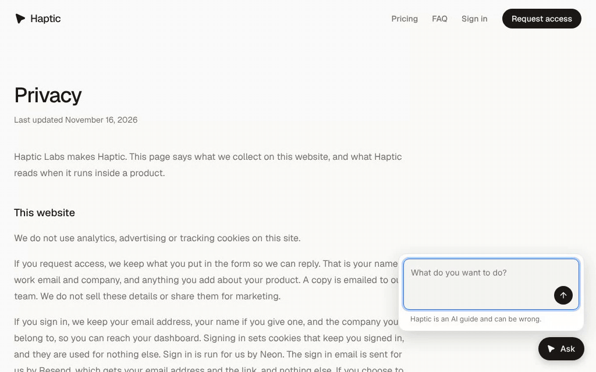
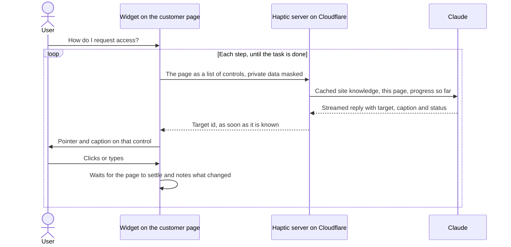

<div align="center">


# Haptic

**The AI guide that lives inside your product.**<br>
Users say what they want to do. Haptic points to exactly where to click, step by step, on the live page.

[Website](https://joinhaptic.com) · [How it works](#how-it-works) · [Benchmark](eval/README.md) · [Docs](#documentation)

[](https://github.com/dartmouth-cs52/project-other-idea/actions/workflows/ci.yml)
[](https://joinhaptic.com)


</div>

<br>



<p align="center"><sub>A real, unscripted run on <a href="https://joinhaptic.com">joinhaptic.com</a> with the production model. The visitor asks one question, and Haptic leads them across a page load and through a form. Try it yourself: click <b>Ask</b> on any page of the site.</sub></p>

## Why Haptic

When someone gets stuck in a web app, the help on offer either sends them somewhere else or doesn't know what their screen looks like today.

| | On the user's screen | Follows the current UI | Points to the exact control |
|---|:---:|:---:|:---:|
| Help center articles | ✗ | ✗ | ✗ |
| Support chatbots | ✓ | ✗ | ✗ |
| Scripted product tours | ✓ | ✗ | ✓ |
| **Haptic** | ✓ | ✓ | ✓ |

Haptic reads the live page on every step, so it follows whatever the product looks like today. A company installs it with one script tag, and Haptic learns the product from what the company already has: the site itself, its help docs, and a few notes.

## Highlights

- **Accurate.** In our [benchmark](eval/README.md#results) of 565 frozen guide steps, it points at the right control on 97% of the steps on Haptic's own sites, about 85% on twelve real apps, and 86% on apps it was never tuned on.
- **Fast.** Replies are streamed, so the pointer starts moving as soon as the model names the control, about 0.8 s into a step in the benchmark run.
- **Private by construction.** It never sends what users type, and leaves it out wherever the page repeats it, except plain words they also wrote in their question (never an email address or a number it masks). Email addresses, long numbers and phone and card numbers are masked in the browser, and again on the server before anything is stored. [Exactly what is masked, and what is not.](#privacy)
- **Safe to put in front of customers.** Spend is capped per site, every sentence is checked against fixed rules on the server, and page content is treated as untrusted input.
- **In production.** The widget server runs on Cloudflare Workers with Postgres on Neon, behind an invite-only dashboard at [joinhaptic.com](https://joinhaptic.com).

## How it works



1. **Snapshot.** The widget (about 170 KB, 58 KB gzipped, no dependencies, isolated in a shadow root; the code for Do it with me, another 96 KB, 34 KB gzipped, loads only on a site with it on) lists every interactive control on the page with a short id, its role, label, state and position (`nav`, `main › Billing`). When a dialog is open, only the dialog is listed.
2. **Decide.** The server sends the snapshot, the goal and the progress so far to Claude. The site's knowledge is a cached prompt, so each step pays full price only for what changed. The reply has a strict schema, and a target that isn't on the page is dropped, so Haptic can only point at what the user can actually see.
3. **Point.** The pointer moves the moment the target id arrives, before the caption has finished streaming.
4. **Observe.** Once the user acts, the widget waits for the page to settle and reports what changed. If they click something else, Haptic notices and gives them the step that gets them back.
5. **Carry on.** Guide state lives in `sessionStorage`, so a guide continues across full page loads.

### What Haptic knows about a site

A crawl turns the site into a **graph**. Each page's title, headings, buttons and field labels make a node, and the links between pages are the edges. The intake CLI reads server-rendered HTML, and the dashboard's reader uses a headless browser. That reader also opens each menu, tab and accordion and records what it showed, so the map knows which control a link sits behind. Real visits fill in what a crawl can't reach: the widget sends the labels on each page it loads on, and what each menu, tab and accordion shows when a visitor opens it, and a label joins the map once three different visitors have seen it ([how](docs/widget.md#learning-the-site-from-visits)). Together with the company's notes and help docs, this gives the model a map it can plan routes through, to pages the user hasn't reached yet.

### Beyond pointing

- **[Answers](docs/answers.md)** (on for a site with help docs): replies in words to questions like "what does this do?", drawn from the site's own help articles, with citations. The server, not the prompt, enforces the rules that matter. An answer must cite a real article. Prices, refunds, legal matters and account specifics are never stated. A button an article names is checked against the live page, so out-of-date docs get flagged instead of repeated.
- **[What people can't find](docs/corrections.md#what-people-cant-find-and-guide-health)**: the dashboard leads with the questions people gave up on, counted by person, and flags a common question whose guides stopped finishing, which is what a change to the product looks like. The company's team gets an email about it.
- **[Corrections](docs/corrections.md#point-here-instead)**: when Haptic points at the wrong thing, the company picks the right control on that step in the dashboard, and the fix applies to similar questions from then on. A company can also list controls Haptic must never point at, which the server and the widget both enforce.
- **[Do it with me](docs/widget.md#do-it-with-me)** (opt-in, per site): on a site that turns it on, a **Do it** button sits beside Send. Haptic clicks, types and chooses on the page while the user watches, lists what it did, and points at the last control, the one that saves, sends or pays, for the user to click. It leaves to the user anything whose name or address says it saves, sends, pays or deletes, never types passwords or payment details, and types only what the user wrote in their question. It does follow a plain link that opens a form page (`/cards/new`), and if a press of its own ever sends something to the site it stops at once ([what it can and cannot tell](docs/widget.md#do-it-with-me)). The user's own click or key pauses it, and Escape stops it. The server checks every action with the same rules as the widget, and a page can turn it off for itself with `data-acting="off"` on the script tag.
- **[Hand-off to a person](docs/answers.md#the-way-to-a-person)**: when Haptic can't help, it passes the conversation to the company's existing support, through a webhook (optionally HMAC-signed), a contact page, email, or the site's own chat widget.

### Privacy

The widget sends the names of controls, never what anyone types into a field or anything inside an area they write in. It looks at what fields hold only inside the browser, to leave it out wherever the page repeats it: a block of page text that repeats it is dropped, and in a heading, the title, a control's name or an option it is replaced by `[typed]` ("Save [typed]"). The one exception is words the person also wrote, whole, in their own question, which is sent anyway: asked to "make Roma Johnston a manager", they type Roma in the search box, and the row "Roma Johnston" stays readable so it can be pointed at. That holds only for words the question is sent with. An email address or a number that is masked in the question is left out when typed like anything else, whether or not the question names it, so the page's repeat of someone's typing never un-masks it. Anything else they type is left out as before. Addresses, the page's own and its links', are sent with ids and numbers masked, so a page that writes a search into an address sends it there. Before anything leaves the browser, in what it reads, in the page's address and in the question, it masks:

- anything that looks like an email address,
- any run of five or more digits, like an account or order number,
- any eight or more digits written in groups with spaces, dashes, dots or brackets, like a phone or card number. Digits that follow straight after a letter belong to the word, like the model number I9100, and are not counted, unless more of a number follows them, as in SSN123-45-6789 or Card4111 1111 1111 1111: then the whole number is masked.

The server masks the same again before it stores anything, with the same function (`cleanText` in `src/shared/types.ts`). What reaches the model is what the widget sent, already masked. Neither masks real dates written in figures, like 2026-03-07 or 07.03.2026, with a month from 1 to 12 and a day from 1 to 31 (12.34.5678 is masked): a question like "my latest invoice" needs them, and they say no more about a person than the names a page already shows. Nor do they mask shorter numbers, like prices and quantities, or names and other words, so text on the page can still hold personal details, a date of birth among them.

One exception, so Haptic can find the order or account someone asked about: an email address, or a number of five or more digits, that the user wrote in their own question is left readable wherever exactly that value stands on its own on the page. In the question itself it is left readable only when the page shows it standing on its own like that, and is masked otherwise (`namedIn`). With each question the widget also sends the user's own date, not their time zone or location, so the model knows what day it is. What is kept is listed in [operations](docs/operations.md#what-is-recorded-about-visitors), and the public [privacy page](web/app/privacy/page.tsx) says the same.

## Engineering

| Area | How |
|---|---|
| **Privacy** | Sends labels, never field values or anything inside an area the user writes in, and leaves what fields hold out of every heading, label and option that repeats it, except plain words the user also wrote in their question (never an email address or a number it masks). Email addresses, long numbers and phone and card numbers are masked in the browser, and again on the server before anything is stored ([what exactly](#privacy)). Exactly what is stored is [documented](docs/operations.md#what-is-recorded-about-visitors), and the public privacy page is kept in line with the code. |
| **Safety** | Page content is fenced off in the prompt as untrusted data. Every outgoing sentence passes server-side rules: no links, contact details, payment details or requests for secrets. The Answers benchmark includes 100 adversarial cases, from prompt injection to mixed harmless and hostile requests. |
| **Cost control** | Per-site knowledge is prompt-cached. Each site has hourly and daily dollar budgets, enforced per step by reserving the step's maximum cost up front. Optional per-visitor limits count against a daily-salted hash of the visitor's address. A kill switch takes Haptic off one site or all of them without a deploy. |
| **Auditable billing** | Pricing charges only for finished guides. "Finished" has one definition shared by the widget, the database and the dashboard, which lists every billable guide with a download. |
| **Evaluation** | A benchmark of frozen guide steps with known right answers, scored for accuracy (with plausible ranges), latency and output hygiene. See the [results](eval/README.md#results). |
| **Stress testing** | Northpine is a fake spend-management app with about 60 routes and 10,000 transactions. It deliberately contains every UI pattern known to break a pointing guide, and comes with 179 tasks. |

## Benchmark

565 frozen single steps with known right answers, 448 of them on twelve real apps, and whole guides run start to finish in a browser. Measured against the live server with Claude Sonnet 5.5 ([full results and caveats](eval/README.md#results)):

| Where | Single steps right | Whole guides that got there |
|---|---|---|
| Haptic's own demo app | 56 / 56 | 13 / 13 |
| Nine real apps (SAP UI5, Ant Design Pro, OrangeHRM, Grafana, Jira and others) | 299 / 352 (85%) | 45 / 85 (53%) |
| Three apps held out of all tuning | 83 / 96 (86%) | 21 / 29 (72%) |

About half the guides that did not get there were lost to the widget before the model had a fair chance: an empty page, a pick it never heard, two unnamed fields taken for one. That gap is the work in progress.

The production model was chosen earlier, from one run of the first 74 cases:

| Model | Right control | Plausible range | Time to pointer | Full step (typical) |
|---|---|---|---|---|
| Claude Sonnet (production) | 73 / 74 | 93–100% | 831 ms | 1449 ms |
| Claude Haiku | 73 / 74 | 93–100% | 949 ms | 1078 ms |
| Claude Opus | 72 / 74 | 91–99% | 1318 ms | 1720 ms |

Sonnet runs in production. It matches the best accuracy, names the control about half a second sooner than Opus, and costs about half as much per step. The ranges overlap, so the next step is more cases, especially from apps behind a login.

## Repository

| Path | What it is |
|---|---|
| [`src/widget`](src/widget) | The embeddable script: page snapshot, guide loop, pointer and panel |
| [`src/server`](src/server) | One request handler (`app.ts`) shared by the local Node server and the production Worker: validation, prompts, model calls, rules, budgets and recording |
| [`src/intake`](src/intake) | A CLI that crawls a site and its help docs, publishes it, and switches it on or off |
| [`worker`](worker) | The Cloudflare Worker entry point for `widget.joinhaptic.com` |
| [`web`](web) | [joinhaptic.com](https://joinhaptic.com) and the customer dashboard |
| [`db/migrations`](db/migrations) | Postgres schema for sites, guides and steps |
| [`eval`](eval) | The guide and Answers benchmarks |
| [`testbed`](testbed) | Northpine, the stress-test app |
| [`demo`](demo) | A small multi-page app for trying the widget locally |
| [`DESIGN.md`](DESIGN.md) | The design system shared by the widget and the website |

**Stack:** TypeScript (strict) · Claude via the Anthropic SDK · Cloudflare Workers · Neon Postgres and Neon Auth · Next.js, Tailwind CSS and shadcn/ui · React and Vite · Resend · esbuild · `node:test` · GitHub Actions · built with [Claude Code](https://claude.com/claude-code)

## Quick start

Requires Node 20.19+ or 22.9+ (CI uses Node 22).

```bash
npm install
cp .env.example .env   # add ANTHROPIC_API_KEY, or set HAPTIC_MODEL=mock to run without one
npm run dev            # http://localhost:4000, with a demo app at /demo/
```

In a second terminal, teach Haptic the demo app:

```bash
npm run tag -- --url http://localhost:4000/demo/ --id site_demo --name "Acme Console" \
  --notes demo/notes.md --docs demo/help
```

Open http://localhost:4000/demo/, click **Ask**, and try *"how do I change my billing info"*. Billing sits behind the account menu, so Haptic has to open that first. With `HAPTIC_MODEL=mock`, a keyword matcher stands in for the model, which is only good for testing the plumbing.

To build a context for any site, run `npm run tag -- --url https://app.example.com --name Example --notes notes.md --docs help/`. It prints the script tag to paste before `</body>`, and `npm run tag -- --help` lists every option.

## Development

```bash
npm test                          # unit tests (node:test)
npm run typecheck                 # tsc, strict
npm run build                     # bundle the widget to dist/widget.js, and the code that acts to dist/widget-act.js
npm run eval -- --models mock     # the guide benchmark, no API key needed
npm run eval:guides -- demo       # whole guides in a browser (needs the local server running)
npm run test:browser              # page reading in Chromium, and the widget in Chromium, Firefox and WebKit
npm run test:widget               # guides, hearing, Do it with me, the gate and red-team pages, in Chromium
```

The browser tests need Playwright's browsers once: `npx playwright install chromium firefox webkit`. The act tests on pages built from the real React, Radix and cmdk also need those libraries for the run (`npm install --no-save react@19 react-dom@19 radix-ui@1 cmdk@1`), and are skipped without them.

`web/` and `testbed/` are separate packages with their own `npm run dev` and `npm run build`. CI typechecks, tests and builds the server, lints and builds the website, and typechecks and builds Northpine, on every push and pull request, and a pull request that touches the widget also runs both browser suites (`widget-tests.yml`). Pushes to `main` deploy the website and the widget server; the widget's deploy first runs the page-reading and widget browser tests and the acting-safety suites (the gate and the red-team pages). A [staging copy of the server](docs/operations.md#the-staging-server), with a small budget of its own, is for trying a change against the real model before visitors get it.

## Documentation

| Doc | Covers |
|---|---|
| [Operations](docs/operations.md) | Deploying, the database, what is recorded about visitors, billing outcomes, the kill switch, spend limits and step costs |
| [The widget on a live page](docs/widget.md) | Modal dialogs, covered controls, route changes, learning the site from visits, putting the launcher away, and the browser tests |
| [Correcting Haptic](docs/corrections.md) | What people can't find, guide health and its emails, "Point here instead", and controls Haptic must never point at |
| [Answers and hand-off](docs/answers.md) | Answering from help docs, the server-side rules, and hand-off to a person |
| [Benchmark](eval/README.md) | How cases work, how to run them, and results |
| [Website and dashboard](web/README.md) | Sign-in, approvals, the dashboard, and deploying the site |
| [Northpine](testbed/README.md) | The stress-test app and its tasks |
| [Design system](DESIGN.md) | Colour, type, radii and motion |

## Status

Haptic is in early access. Known limits:

- The command-line crawler reads server-rendered HTML, so pages drawn by JavaScript or behind a login come back thin. The widget still reads every page live, so those sites lean more on notes and docs.
- Nothing inside a rich-text editor can be pointed at. This is deliberate: the widget reads nothing inside an area the user writes in.
- Answers is on for any site with help docs. It has been run against a real model on one app, Northpine: whole guides and a few questions of fact, not its own benchmark of answers (`npm run eval:answers`). A how-to question is guided to the end there as on a site without it ([how](docs/answers.md)).
- Do it with me is off by default. It does not pick dates yet: a date field is handed to the user.
- Real apps the prompt and widget were never tuned on score below the ones they were (86% of single steps against 97% on Haptic's own sites), and about half the whole guides on real apps get there.

## Team

Haptic started in Dartmouth's CS 52 (Full-Stack Web Development). It's built by:

- **Theodore Chan** ([@TheoC26](https://github.com/TheoC26))
- **Charlie Peers** ([@charliepeers](https://github.com/charliepeers))
- **Isaac Saxonov** ([@clewner](https://github.com/clewner))
