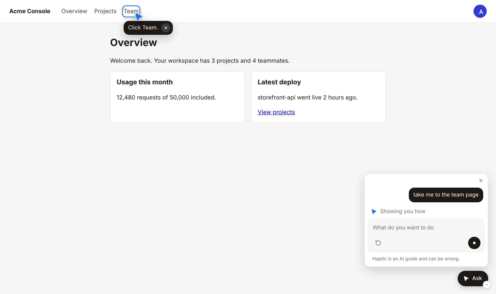
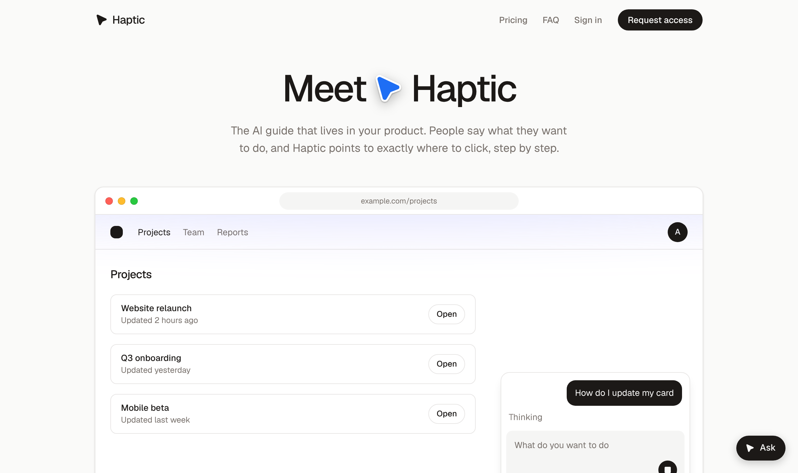
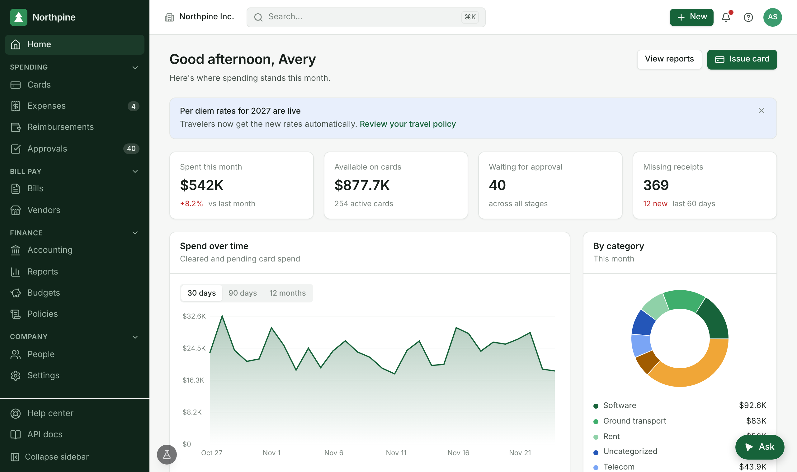
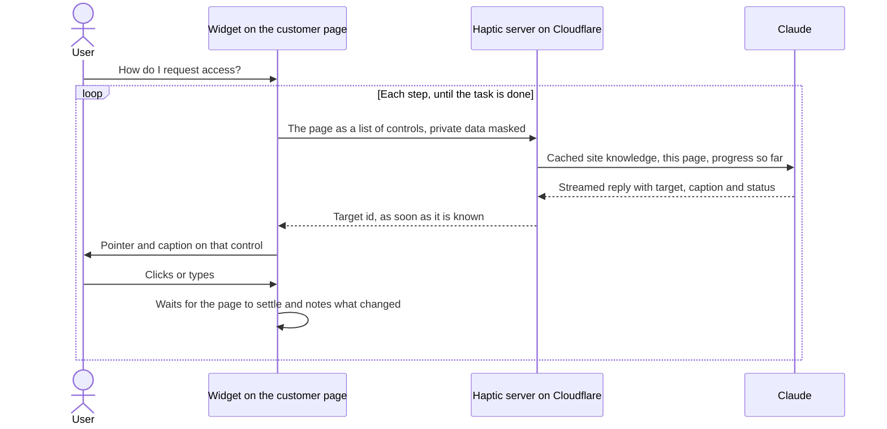
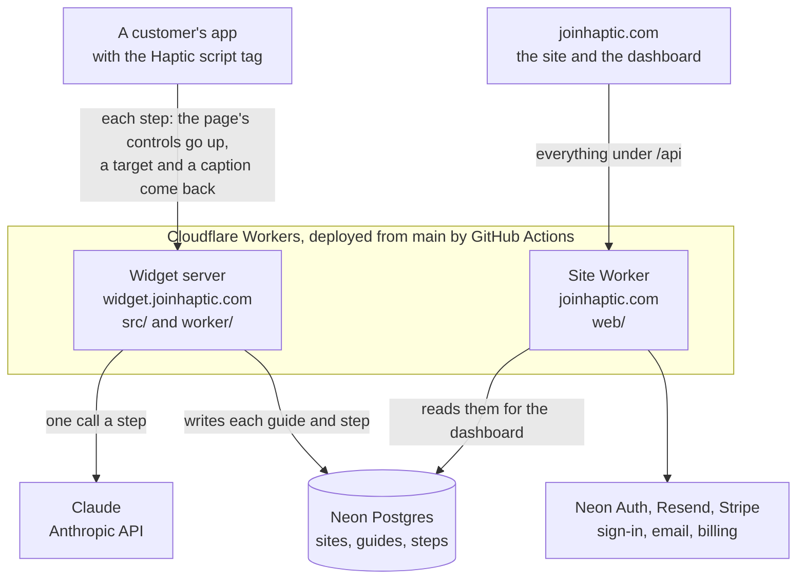

<div align="center">

<h1>
  <picture>
    <source media="(prefers-color-scheme: dark)" srcset="assets/logo-dark.svg">
    
  </picture>
</h1>

**The AI guide that lives in your product.**<br>
People say what they want to do, and Haptic points to exactly where to click, step by step.

[Live app](https://joinhaptic.com) · [Demo app](https://demo.joinhaptic.com) · [What it is](#what-it-is) · [Architecture](#architecture) · [Setup](#setup) · [Deployment](#deployment) · [Team](#team)

[](https://github.com/dartmouth-cs52/project-other-idea/actions/workflows/ci.yml)
[](https://joinhaptic.com)


</div>

<br>


<p align="center"><sub>A real, unscripted run on <a href="https://joinhaptic.com">joinhaptic.com</a> with the production model. The visitor asks one question, and Haptic leads them across a page load and through a form. To try it, click <b>Ask</b> on any page of the site.</sub></p>

## What it is

Haptic is an AI guide that a company adds to its web app with one script tag. A user types what they want to do, and Haptic reads the page in front of them and points at the exact control to click, one step at a time, across page loads and through forms. It learns the product from the site itself, its help docs and a few notes, so nobody writes a tour or maintains a selector.

- **The app is at [joinhaptic.com](https://joinhaptic.com).** Click **Ask** on any page to try the guide. Companies sign in there, by invitation, to add their site and see what their users asked.
- **Haptic inside an app is at [demo.joinhaptic.com](https://demo.joinhaptic.com).** That is Northpine, a made-up spend-management product with the live widget on it.



<p align="center"><sub>The widget in the middle of a guide, on the small demo app in <code>demo/</code>, run from a fresh clone with the stand-in model. The question is in the panel, the pointer and its outline are on the next control, and the caption says what to do with it.</sub></p>

| [joinhaptic.com](https://joinhaptic.com) | [Northpine](https://demo.joinhaptic.com), the demo app |
|---|---|
|  |  |

When someone gets stuck in a web app, the help on offer either sends them somewhere else or doesn't know what their screen looks like today.

| | On the user's screen | Follows the current UI | Points to the exact control |
|---|:---:|:---:|:---:|
| Help center articles | ✗ | ✗ | ✗ |
| Support chatbots | ✓ | ✗ | ✗ |
| Scripted product tours | ✓ | ✗ | ✓ |
| **Haptic** | ✓ | ✓ | ✓ |

Haptic reads the page on every step, so it follows whatever the product looks like today.

## At a glance

| Claim | Evidence |
|---|---|
| **Accurate** | Points at the right control on 97% of steps on Haptic's own sites, 85% on twelve real apps, and 86% on the three of those held out of all tuning. [Method, results for each app and caveats.](eval/README.md#results) |
| **Fast** | Replies are streamed, so the pointer moves as soon as the model names the control, about 0.8 s into a step. |
| **Small** | One script, 67 KB gzipped, with no dependencies, isolated in a shadow root. The code for Do it with me, teach mode and mapping loads only where it is used. |
| **Safe on pages it has never seen** | Put into 107 public websites, it mounted on all 90 that could be tested and disturbed none of them while idle. It threw no errors, moved no elements and left the focus order as it was. [The same run lists what it still gets wrong.](eval/README.md#does-the-tag-work-on-any-website) |
| **Private by construction** | What a user types is never sent. Email addresses and long numbers are masked in the browser, and again on the server before anything is stored. [Exactly what, and the exceptions.](docs/privacy.md) |
| **Tested** | 109 test files, about 30,000 lines of tests for about 33,000 lines of widget, server and Worker code, including red-team pages and browser suites in Chromium, Firefox and WebKit. |
| **In production** | The widget server runs on Cloudflare Workers with Postgres on Neon, deployed from `main` by GitHub Actions, behind an invite-only dashboard at [joinhaptic.com](https://joinhaptic.com). |

## How it works



1. **Snapshot.** The widget lists every interactive control on the page with a short id, its role, label, state and position, such as `nav` or `main › Billing`. When a dialog is open, only the dialog is listed.
2. **Decide.** The server sends the snapshot, the goal and the progress so far to Claude. The site's knowledge is a cached prompt, so each step pays full price only for what changed. The reply has a strict schema, and a target that isn't on the page is dropped, so Haptic can only point at what the user can see.
3. **Point.** The pointer moves the moment the target id arrives, before the caption has finished streaming.
4. **Observe.** Once the user acts, the widget waits for the page to settle and reports what changed. If they click something else, Haptic notices and gives them the step that gets them back.
5. **Carry on.** Guide state lives in `sessionStorage`, so a guide continues across full page loads.

### What Haptic knows about a site

A crawl turns the site into a **graph**. Each page's title, headings, buttons and field labels make a node, and the links between pages are the edges. The dashboard's reader uses a headless browser and also opens each menu, tab and accordion, so the map knows which control a link sits behind. Real visits fill in what a crawl can't reach. The widget reports the labels on each page it loads on, and a label joins the map once three different visitors have seen it. [How visits teach it.](docs/widget.md#learning-the-site-from-visits) And someone at the company can have Haptic go through their signed-in app by itself, from the dashboard, which adds what each button, menu and dialog leads to. [How mapping works.](docs/widget.md#mapping-the-signed-in-app) Together with the company's notes and help docs, this gives the model a map it can plan routes through, to pages the user hasn't reached yet.

## Architecture

Three things run online, each a Cloudflare Worker. Two of them share one Postgres database.



The third Worker is Northpine, the demo at `demo.joinhaptic.com`. It has no backend, and loads the widget from the widget server like any customer's app.

- **The widget** (`src/widget`) is the script a customer pastes into their app. It reads the page, draws the pointer and the panel inside a shadow root, and talks only to the widget server.
- **The widget server** (`src/server`) is one request handler, `app.ts`, that runs in two places: under Node on your machine (`src/server/index.ts`) and as a Cloudflare Worker online (`worker/index.ts`). It validates each step, builds the prompt, calls Claude, checks the reply against its rules, keeps each site inside its budget and records the guide. A KV namespace holds the off switch, and a Durable Object holds what each site has spent.
- **The site Worker** (`web/`) serves joinhaptic.com as static pages from Next.js, and answers everything under `/api/`: the request-access form, sign-in through Neon Auth, the dashboard's queries, reading a new customer's site in a headless browser, billing through Stripe and email through Resend.
- **The database** is Postgres on Neon. The widget server writes each question and step as it happens, and the dashboard reads them from there, so there is no socket between the two.
- **Northpine** (`testbed/`) is a client-only React app, built to contain every UI pattern known to break a pointing guide.

### How the code is organized

Three npm packages, each with its own `package.json` and lockfile: the top of the repository, `web/` and `testbed/`. `mac/` is a Swift package.

| Path | What it is |
|---|---|
| [`src/widget`](src/widget) | The embeddable script, with the page snapshot, guide loop, pointer and panel |
| [`src/server`](src/server) | One request handler, `app.ts`, shared by the local Node server and the production Worker. It does validation, prompts, model calls, rules, budgets and recording |
| [`src/shared`](src/shared) | Types and rules the widget, the server and the dashboard all use, such as masking and what counts as a finished guide |
| [`src/intake`](src/intake) | A CLI that crawls a site and its help docs, publishes it, and switches it on or off |
| [`src/db`](src/db) | The migration runner and a report on verified routes |
| [`worker`](worker) | The Cloudflare Worker entry point for `widget.joinhaptic.com`, and the budget meter |
| [`web`](web) | [joinhaptic.com](https://joinhaptic.com), the customer dashboard, and the Worker behind them |
| [`db/migrations`](db/migrations) | The Postgres schema, one numbered SQL file a change |
| [`eval`](eval) | The guide and Answers benchmarks, and the any-website sweep |
| [`test`](test) | Unit tests, browser tests and the red-team pages |
| [`testbed`](testbed) | Northpine, the stress-test app and live demo |
| [`demo`](demo) | A small multi-page app for trying the widget locally |
| [`mac`](mac) | HapticKit, the start of Haptic for Mac apps, in Swift. It turns a window's accessibility tree into the same list of controls the widget makes from a page, masks it by the same rules, and asks the same server. See [Status](#status) for what it lacks |
| [`docs`](docs) | How each part works, listed under [Documentation](#documentation) |
| [`DESIGN.md`](DESIGN.md) | The design system shared by the widget and the website |
| [`AGENTS.md`](AGENTS.md) | What a coding agent needs to know to work here |
| [`.github/workflows`](.github/workflows) | CI, the browser suites, the benchmark and the deploys |

**Stack.** TypeScript throughout, apart from the Swift in `mac/`. Claude through the Anthropic SDK. Cloudflare Workers with KV, Durable Objects, rate limits and Browser Rendering. Neon Postgres and Neon Auth. Next.js 16, React 19, Tailwind CSS 4 and shadcn/ui for the site and dashboard. React, Vite and Radix for Northpine. Stripe for billing and Resend for email. esbuild, Playwright, `node:test` and GitHub Actions.

## Engineering

The pointer is the easy part. Most of the code is what makes it safe to put in front of someone else's customers.

| Problem | How Haptic handles it |
|---|---|
| **A model that points at something that isn't there** | The model never returns coordinates or selectors, only the id of a control from the snapshot it was sent. The reply is checked against a strict schema, and a target that isn't on the page is dropped. |
| **Pages that try to give the model orders** | Page content is fenced off in the prompt as untrusted data, and every outgoing sentence passes rules on the server that drop links, contact details, payment details and requests for secrets. In the benchmark's hostile cases, text planted on the page was followed 0 times in 10. |
| **Private data on the page** | The widget sends labels, never field values, and leaves what a user typed out of every heading, label and option that repeats it. Email addresses, long numbers and phone and card numbers are masked in the browser and again on the server, by the same function. See [what is masked](docs/privacy.md) and [what is stored](docs/operations.md#what-is-recorded-about-visitors). |
| **An unbounded model bill** | Each site's knowledge is prompt-cached. Each site has hourly and daily dollar budgets, enforced on every step by reserving the step's maximum cost up front and settling to the real cost afterwards. Optional limits for each visitor count against a daily-salted hash of their address. A kill switch takes Haptic off one site, or all of them, without a deploy. See [spend limits](docs/operations.md#what-a-site-can-spend). |
| **Knowing whether a change made it better** | A [benchmark](eval/README.md) of 565 frozen steps with known right answers, scored for accuracy, latency and output hygiene, plus whole guides run start to finish in a browser. A staging copy of the server measures a prompt change against the real model before visitors get it. |
| **Real apps are harder than demos** | [Northpine](testbed/README.md) is a fake spend-management app with about 60 routes and 10,000 transactions. It is built to contain every UI pattern known to break a pointing guide, among them virtualized tables, portals, nested dialogs and command palettes. It comes with 179 tasks. |
| **Billing people can check** | Pricing charges only for finished guides. Finished has one definition shared by the widget, the database and the dashboard, which lists every billable guide with a download. |

### Beyond pointing

- **[Answers](docs/answers.md).** On a site with help docs, Haptic answers questions about what something does in words, citing the articles it drew on. The server, not the prompt, enforces the rules that matter. An answer must cite a real article. Prices, refunds and legal matters are never stated. A button an article names is checked against the page, so out-of-date docs get flagged instead of repeated.
- **[Do it with me](docs/widget.md#do-it-with-me).** Off unless a site turns it on. Haptic clicks, types and chooses on the page while the user watches, then points at the last control, the one that saves, sends or pays, for the user to click. It never types passwords or payment details, types only what the user wrote in their question, and stops on Escape. The server checks every action with the same rules as the widget.
- **[What people can't find](docs/corrections.md#what-people-cant-find-and-guide-health).** The dashboard leads with the questions people gave up on, and flags a common question whose guides stopped finishing, which is what a change to the product looks like.
- **[Teach Haptic](docs/corrections.md#teach-haptic).** When Haptic gets a question wrong, someone at the company presses Teach Haptic the right way in the dashboard. Their app opens with a one-time link, and they do the task once while the widget records which controls they use, never what they type. They review the steps, and from then on a question for the same task, the same action on the same thing, is guided along that route. The model still checks each step against the live page.
- **[Corrections](docs/corrections.md#point-here-instead).** When Haptic points at the wrong thing, the company picks the right control in the dashboard and the fix applies to similar questions from then on. A company can also list controls Haptic must never point at.
- **[Hand-off to a person](docs/answers.md#the-way-to-a-person).** When Haptic can't help, it passes the conversation to the company's existing support through a webhook, a contact page, email or the site's own chat widget. The webhook can be HMAC-signed.

## Benchmark

565 frozen single steps with known right answers, 448 of them on twelve real apps, and whole guides run start to finish in a browser. Measured against the production server with Claude Sonnet 5.5, every case run once. [Full results and caveats.](eval/README.md#results)

| Where | Single steps right | Whole guides that got there |
|---|---|---|
| Haptic's own demo app | 56 of 56 | 13 of 13 |
| joinhaptic.com | 15 of 17 | 4 of 5 |
| Hostile, off-topic, risky and badly asked questions on the demo app | 39 of 44, 89% | 3 of 3 |
| Nine real apps, among them SAP UI5, Ant Design Pro, OrangeHRM, Grafana and Jira | 299 of 352, 85% | 45 of 85, 53% |
| Three apps held out of all tuning, EspoCRM, GitLab and Moodle | 83 of 96, 86% | 21 of 29, 72% |

The gap between single steps and whole guides on real apps is the finding. About half the guides that did not get there were lost to the widget before the model had a fair chance, to an empty page, a pick it never heard, or two unnamed fields taken for one. That gap is the work in progress.

The production model was chosen earlier, from one run of the first 74 cases.

| Model | Right control | Plausible range | Time to pointer | Typical full step |
|---|---|---|---|---|
| Claude Sonnet, in production | 73 of 74 | 93 to 100% | 831 ms | 1449 ms |
| Claude Haiku | 73 of 74 | 93 to 100% | 949 ms | 1078 ms |
| Claude Opus | 72 of 74 | 91 to 99% | 1318 ms | 1720 ms |

Sonnet matches the best accuracy, names the control about half a second sooner than Opus, and costs about half as much per step. The ranges overlap, so the next step is more cases, especially from apps behind a login.

## Setup

Every step from a fresh clone to Haptic guiding you through a page. It needs Node 20.19+ or 22.9+ and npm, and nothing else: no database and no Cloudflare account. CI uses Node 22.

### 1. Clone and install

```bash
git clone https://github.com/dartmouth-cs52/project-other-idea.git
```

```bash
cd project-other-idea
```

```bash
npm ci
```

### 2. Make your `.env`

```bash
cp .env.example .env
```

Then open `.env` and do one of two things.

- **With a Claude API key.** Put it after `ANTHROPIC_API_KEY=`. This is the real product.
- **Without one.** Change `HAPTIC_MODEL` to `mock`. A keyword matcher stands in for the model, which is enough to see the widget work and no more.

Do one of them. With the file left as it was copied, the server starts without complaint and every question gets "Something went wrong on our side", with the reason only in the server's log.

### 3. Start the server

```bash
npm run dev
```

It builds the widget and serves it at http://localhost:4000, with a small demo app at http://localhost:4000/demo/. Leave it running.

### 4. Teach Haptic the demo app

In a second terminal:

```bash
npm run tag -- --url http://localhost:4000/demo/ --id site_demo --name "Acme Console" \
  --notes demo/notes.md --docs demo/help
```

This reads the demo app's pages, notes and help docs and saves what it learned to `data/sites/site_demo.json`. Until it has run, the demo page has no Ask button, and the browser's console says there is no site with that id. A line saying Playwright's browser isn't installed is expected, and doesn't matter for the demo app, whose pages are plain HTML.

### 5. Ask it something

Open http://localhost:4000/demo/ and click **Ask**.

- **With a key,** try *how do I change my billing info*. Billing sits behind the account menu, so Haptic has to open that first.
- **With `HAPTIC_MODEL=mock`,** try *take me to the team page*. The stand-in only matches words in the question against labels on the page in front of it, so it cannot find billing, which is behind a menu, and answers that question with "That needs an answer from a person at Acme Console".

To build a context for any site, run `npm run tag -- --url https://app.example.com --name Example --notes notes.md --docs help/`. It prints the script tag to paste before `</body>`, and `npm run tag -- --help` lists every option.

### Environment variables

The widget server reads these from `.env` at the top of the repository. `.env.example` lists them with the same notes.

| Name | Needed | What it is, and where to get it |
|---|---|---|
| `HAPTIC_MODEL` | Yes | A Claude model ID, or `mock`. Already set in `.env.example` to the model the live server runs. |
| `ANTHROPIC_API_KEY` | Unless `HAPTIC_MODEL=mock` | A Claude API key, from the [Claude Console](https://console.anthropic.com/settings/keys) under API keys. |
| `HAPTIC_PUBLIC_URL` | Yes, already set | Where browsers reach this server. It goes into the script tag that `npm run tag` prints. `http://localhost:4000` on your machine. |
| `PORT` | Yes, already set | The port the server listens on. |
| `DATABASE_URL` | No | A Neon connection string, from the [Neon console](https://console.neon.tech): the project, then Connect. With it, sites are read from Neon as they are online, guides and steps are recorded for the dashboard, and `npm run db:migrate` and `npm run site:publish` have a database to work on. Without it, sites are read from `data/sites/` and nothing is recorded. Use a branch made for testing. |
| `STRIPE_SECRET_KEY` | No | Billing only. A test-mode secret key from Stripe's dashboard, under Developers, API keys. |
| `HAPTIC_EFFORT`, `HAPTIC_THINKING`, `HAPTIC_CACHE`, `HAPTIC_OFF`, `HAPTIC_BUDGET_HOUR`, `HAPTIC_BUDGET_DAY`, `HAPTIC_MOCK_USD`, `HAPTIC_RECORD` | No | Tuning. Each is explained beside its line in `.env.example`, and none is a secret. |

### The website and dashboard

Optional. `web/` is its own package.

```bash
cd web
```

```bash
npm ci
```

```bash
npm run dev
```

That serves the pages at http://localhost:3000. It runs the pages only, so the request form, sign-in and the dashboard have nothing to talk to. To run the Worker behind them as well, use `npm run preview`, which builds the site and serves it with the Worker at http://localhost:8787. With no secrets set, the pages load and the dashboard says the database is not set up.

For sign-in and a working dashboard, copy `web/.dev.vars.example` to `web/.dev.vars` and fill it in. It needs a Neon project with Neon Auth turned on, with the migrations applied to it ([below](#database-migrations)).

| Name | Needed | What it is, and where to get it |
|---|---|---|
| `DATABASE_URL` | Yes | The Neon connection string for a branch made for testing. Neon console: the project, then Connect. |
| `NEON_AUTH_URL` | Yes | That branch's Neon Auth address, from the branch's Auth page in the Neon console. Not a secret. |
| `NEON_AUTH_COOKIE_SECRET` | Yes | 32 or more random characters. Make one with `openssl rand -base64 32`. |
| `APPROVE_SECRET` | Yes | 32 or more random characters, a different one. It signs the Approve links in access-request emails. |
| `RESEND_API_KEY` | Yes | Sends the sign-in email. From [Resend](https://resend.com)'s dashboard under API Keys, with sending access only. |
| `WIDGET_URL` | Yes, already set | The widget server. `http://localhost:4000` on your machine. Not a secret. |
| `NOTIFY_TO` | No | The inbox that gets a copy of each access request. |
| `STRIPE_SECRET_KEY`, `STRIPE_WEBHOOK_SECRET` | No | Billing only. The key is from Stripe's dashboard under Developers, API keys. `stripe listen` prints the webhook secret. |

The rest of that setup, what to switch on in Neon Auth and the two commands that run the site against a local widget server, is in [web/README.md](web/README.md#sign-in-approval-and-the-dashboard).

### Northpine

Optional. `testbed/` is its own package, with no backend and nothing to configure.

```bash
cd testbed
```

```bash
npm ci
```

```bash
npm run dev
```

It runs at http://localhost:4200. To put Haptic on it, follow [Try Haptic on it](testbed/README.md#try-haptic-on-it).

## Development

From the top of the repository:

```bash
npm test                          # unit tests (node:test)
npm run typecheck                 # tsc, strict
npm run build                     # bundle the widget to dist/widget.js, and the code that acts to dist/widget-act.js
npm run eval -- --models mock     # the guide benchmark, no API key needed
npm run eval:guides -- demo       # whole guides in a browser (needs the local server running)
npm run test:browser              # page reading in Chromium, and the widget in Chromium, Firefox and WebKit
npm run test:dashboard            # the built dashboard in Chromium, kept current from a real Postgres (see below)
npm run test:widget               # guides, hearing, Do it with me, the gate and red-team pages, in Chromium
```

`npm test` needs nothing but `npm ci`. Tests that need a browser or a database skip themselves and say what is missing.

The browser tests need Playwright's browsers once, with `npx playwright install chromium firefox webkit`. The act tests on pages built from the real React, Radix and cmdk also need those libraries for the run, and are skipped without them. Install them with `npm install --no-save react@19 react-dom@19 radix-ui@1 cmdk@1`.

The dashboard tests open the pages `next build` writes, so build the site first. They read every number from a local Postgres through the Worker's own queries, so they need `TEST_DATABASE_URL` set to an empty local database, never a real one. Run them with `cd web && npm run build && cd .. && TEST_DATABASE_URL=postgres://postgres@127.0.0.1:55432/haptic_test npm run test:dashboard`. A test writes a question and its steps to the database as the widget server does, and waits for the open page to show them by itself. Without the build or the database they are skipped, and say which is missing. `dashboard-tests.yml` runs them on every pull request that touches the dashboard.

On every push and pull request, CI typechecks, tests and builds the server, lints, tests and builds the website, and builds Northpine and checks that each of its pages fits a phone. A pull request that touches the widget also runs both browser suites, in `widget-tests.yml`.

## Deployment

### How `main` gets deployed

Merging to `main` is the deploy. Three GitHub Actions workflows watch it, each for its own part of the repository, and each publishes one Cloudflare Worker. Pull requests never deploy, so nothing goes live before a merge. Each can also be started by hand from the Actions tab.

| Workflow | Runs when a push to `main` changes | Publishes |
|---|---|---|
| [`deploy-widget.yml`](.github/workflows/deploy-widget.yml) | `src/`, `worker/`, `wrangler.jsonc`, `package.json`, `package-lock.json` or `db/migrations/` | The widget server, at `widget.joinhaptic.com` |
| [`deploy-site.yml`](.github/workflows/deploy-site.yml) | `web/`, apart from its docs, or `db/migrations/` | The website and dashboard, at `joinhaptic.com` |
| [`deploy-demo.yml`](.github/workflows/deploy-demo.yml) | `testbed/`, apart from its docs | Northpine, at `demo.joinhaptic.com` |

The widget server's deploy runs, in order: the typecheck, the unit tests, the page-reading and widget tests in Chromium, the acting-safety suites (the gate and the red-team pages), the database migrations, the publish, and a check that the live server answers. The website's runs the lint, a check that Stripe charges what the pricing page says, the migrations, the build and publish, and a check that the live site answers. A step that fails stops the deploy there.

A fourth workflow, [`deploy-staging.yml`](.github/workflows/deploy-staging.yml), publishes a [staging copy of the widget server](docs/operations.md#the-staging-server) when the branch called `staging` is pushed. It has a small budget of its own, and is for measuring a change against the real model before visitors get it.

### Repository secrets

The deploys read these from the repository's settings, under Settings, Secrets and variables, Actions.

| Name | Needed by | Where to get it |
|---|---|---|
| `CLOUDFLARE_API_TOKEN` | Every deploy | Cloudflare's dashboard, under My Profile, API Tokens. Make one from the "Edit Cloudflare Workers" template. |
| `CLOUDFLARE_ACCOUNT_ID` | Every deploy | Cloudflare's dashboard, on the account's Workers overview. |
| `DATABASE_URL` | The widget server and the website. Neither deploys without it. | The Neon console: the haptic project's main branch, then Connect. |
| `ANTHROPIC_API_KEY` | The widget server and staging, which copy it onto the Worker. Also the benchmark workflow. | The Claude Console, under API keys. Give the server a workspace of its own with a monthly spend limit. |
| `STRIPE_SECRET_KEY`, `STRIPE_WEBHOOK_SECRET`, `STRIPE_PRICES_KEY` | Optional, for billing | Stripe's dashboard, and `npm run stripe:setup` in `web/`. See [Billing](web/README.md#billing). |

A few secrets are put on a Worker once, by hand, with `npx wrangler secret put <NAME>`, and stay across deploys. On the widget server that is `DATABASE_URL`, and `HAPTIC_ALERT_WEBHOOK` if budget alerts should reach a chat channel. On the site Worker, from `web/`, it is `DATABASE_URL`, `NEON_AUTH_COOKIE_SECRET`, `APPROVE_SECRET`, `RESEND_API_KEY` and `NOTIFY_TO`. [Operations](docs/operations.md#deploying) and [web/README.md](web/README.md#deploying) have the rest.

### Database migrations

The schema is the numbered SQL files in [`db/migrations`](db/migrations). One command applies the ones a database is missing, in file name order, each in its own transaction, and records them in `schema_migrations` so none runs twice.

```bash
npm run db:migrate -- --check   # only list what is missing
```

```bash
npm run db:migrate              # apply what is missing
```

Both read the database from `DATABASE_URL`, in `.env` or the environment, and talk to Neon over HTTPS.

Online, nobody runs it by hand. The widget server's deploy and the website's both run it before they publish, and a change to `db/migrations` alone starts both. Migrations only ever add, so the code already live keeps working on the migrated database. To change the schema, add a file with the next number and merge it. [More on the database.](docs/operations.md#the-database)

### Deploying by hand

```bash
npm run deploy                  # the widget server, from the top of the repository
```

```bash
npm run deploy:embedded         # the website, from web/
```

Both need a Cloudflare API token in `CLOUDFLARE_API_TOKEN`, and go straight to the live addresses. Apply the migrations first.

## Documentation

| Doc | Covers |
|---|---|
| [Operations](docs/operations.md) | Deploying, the database, what is recorded about visitors, what Teach Haptic keeps, billing outcomes, the kill switch, spend limits, step costs and verified routes |
| [Privacy](docs/privacy.md) | What leaves the browser, what is masked first, and the exceptions |
| [The widget on a page](docs/widget.md) | Modal dialogs, covered controls, what a form needs before its button, route changes, Do it with me, teach mode, learning the site from visits, mapping the signed-in app, and the browser tests |
| [Correcting Haptic](docs/corrections.md) | What people can't find, guide health and its emails, Point here instead, Teach Haptic, and controls Haptic must never point at |
| [Haptic in a Mac app](docs/mac.md) | HapticKit, the Swift package that does in a native Mac app what the widget does on a page: how a window is read, the menu bar, privacy, and what is not built yet |
| [Northpine for Mac](docs/mac-northpine.md) | The large Mac app Haptic is tried on: its screens and what makes each hard, the Lab, how its site file is written from the app itself, the sixteen tasks and their results, and what building it found in HapticKit |
| [Answers and hand-off](docs/answers.md) | Answering from help docs, the server-side rules, and hand-off to a person |
| [Benchmark](eval/README.md) | How cases work, how to run them, and results |
| [Website and dashboard](web/README.md) | Sign-in, approvals, the dashboard, the team, billing, and deploying the site |
| [Northpine](testbed/README.md) | The stress-test app and its tasks |
| [Design system](DESIGN.md) | Colour, type, radii and motion |
| [Working here as an agent](AGENTS.md) | The layout, the commands, and what has to change together |

## Status

Haptic is in early access. It is running, by invitation, and free until billing starts. These are its known limits.

- On real apps a single step is right about 85% of the time, and about half the whole guides get there. On Haptic's own sites it is 97% and nearly all of them.
- The command-line crawler reads each page in a browser only when Playwright's Chromium is installed (`npx playwright install chromium`). Without it, it reads the HTML the server sends, so pages drawn by JavaScript come back thin. Pages behind a login need a saved session (`--session`) or mapping from the dashboard. The widget still reads every page as the user sees it, so a thinly crawled site leans more on notes and docs.
- Nothing inside a rich-text editor, a canvas or a frame from another origin can be pointed at. For editors this is deliberate, because the widget reads nothing inside an area the user writes in.
- Answers has been run against a real model on one app, Northpine. Its own benchmark of 220 questions, 100 of them attacks, is built and has not yet been run against a real model.
- Do it with me is off by default. It does not pick dates yet, so a date field is handed to the user.
- Haptic for Mac apps has been started and does not run in an app yet. `mac/` has the reader, the masking and the calls to the server, and a site can list a Mac app among the places it runs, by its bundle identifier. The part that reads a running app's own window, and anything that draws the pointer over it, are not in the repository. CI does not build or test the Swift package.

## How it was built

Haptic is written with [Claude Code](https://claude.com/claude-code), and the commit history shows it. Most commits are authored by the agent. The team's work is what the agent is pointed at and what it is held to. We decide what to build, and we set the bar a change has to clear before it merges. That bar is the frozen benchmark, the red-team pages, the browser suites, and a staging server for measuring a change to the prompt against the real model before visitors get it. A large share of this repository is that bar and not the product, namely the benchmark, Northpine, the any-website sweep and about as many lines of tests as of code under test.

## Team

Haptic started in Dartmouth's CS 52, Full-Stack Web Development. It's built by three people.

- **Charlie Peers**, [@charliepeers](https://github.com/charliepeers). The production server and its deployment, the benchmark, cost controls, Answers and hand-off, Do it with me, privacy masking, sign-in, the dashboard and onboarding flow, and joinhaptic.com.
- **Theodore Chan**, [@TheoC26](https://github.com/TheoC26). Northpine, how the widget follows a page through dialogs, covered controls and route changes, learning a site from visits, corrections and guide health.
- **Isaac Saxonov**, [@clewner](https://github.com/clewner). The first version of the widget, server and site crawler that the rest grew from, and mapping pages behind a sign-in.

## Licence

All rights reserved. The code is public so that it can be read, and the [LICENSE](LICENSE) allows nothing more without permission.
