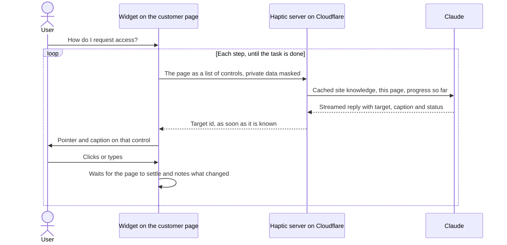

<div align="center">


# Haptic

**The AI guide that lives inside your product.**<br>
Users say what they want to do. Haptic points to exactly where to click, step by step, on the live page.

[Website](https://joinhaptic.com) · [How it works](#how-it-works) · [Benchmark](eval/README.md) · [Docs](#documentation)

[](https://github.com/dartmouth-cs52/project-other-idea/actions/workflows/ci.yml)
[](https://joinhaptic.com)


</div>

<br>


<p align="center"><sub>A real, unscripted run on <a href="https://joinhaptic.com">joinhaptic.com</a> with the production model. The visitor asks one question, and Haptic leads them across a page load and through a form. Try it yourself: click <b>Ask</b> on any page of the site.</sub></p>

## Why Haptic

When someone gets stuck in a web app, the help on offer either sends them somewhere else or doesn't know what their screen looks like today.

| | On the user's screen | Follows the current UI | Points to the exact control |
|---|:---:|:---:|:---:|
| Help center articles | ✗ | ✗ | ✗ |
| Support chatbots | ✓ | ✗ | ✗ |
| Scripted product tours | ✓ | ✗ | ✓ |
| **Haptic** | ✓ | ✓ | ✓ |

Haptic reads the live page on every step, so it follows whatever the product looks like today. A company installs it with one script tag, and Haptic learns the product from what the company already has: the site itself, its help docs, and a few notes.

## Highlights

- **Accurate.** It pointed at the right control on 73 of 74 frozen guide steps in our [benchmark](eval/README.md#results), which is how the production model was chosen.
- **Fast.** Replies are streamed, so the pointer starts moving as soon as the model names the control, about 0.8 s into a step in the benchmark run.
- **Private by construction.** It never reads what users type. Emails, phone numbers and long numbers are masked in the browser, and again on the server.
- **Safe to put in front of customers.** Spend is capped per site, every sentence is checked against fixed rules on the server, and page content is treated as untrusted input.
- **In production.** The widget server runs on Cloudflare Workers with Postgres on Neon, behind an invite-only dashboard at [joinhaptic.com](https://joinhaptic.com).

## How it works



1. **Snapshot.** The widget (about 38 KB, no dependencies, isolated in a shadow root) lists every interactive control on the page with a short id, its role, label, state and position (`nav`, `main › Billing`). When a dialog is open, only the dialog is listed.
2. **Decide.** The server sends the snapshot, the goal and the progress so far to Claude. The site's knowledge is a cached prompt, so each step pays full price only for what changed. The reply has a strict schema, and a target that isn't on the page is dropped, so Haptic can only point at what the user can actually see.
3. **Point.** The pointer moves the moment the target id arrives, before the caption has finished streaming.
4. **Observe.** Once the user acts, the widget waits for the page to settle and reports what changed. If they click something else, Haptic notices and gives them the step that gets them back.
5. **Carry on.** Guide state lives in `sessionStorage`, so a guide continues across full page loads.

### What Haptic knows about a site

A crawl turns the site into a **graph**. Each page's title, headings, buttons and field labels make a node, and the links between pages are the edges. The intake CLI reads server-rendered HTML, and the dashboard's reader uses a headless browser. Together with the company's notes and help docs, this gives the model a map it can plan routes through, to pages the user hasn't reached yet.

### Beyond pointing

- **[Answers](docs/answers.md)** (opt-in): replies in words to questions like "what does this do?", drawn from the site's own help articles, with citations. The server, not the prompt, enforces the rules that matter. An answer must cite a real article. Prices, refunds, legal matters and account specifics are never stated. A button an article names is checked against the live page, so out-of-date docs get flagged instead of repeated.
- **[Hand-off to a person](docs/answers.md#the-way-to-a-person)**: when Haptic can't help, it passes the conversation to the company's existing support, through a webhook (optionally HMAC-signed), a contact page, email, or the site's own chat widget.

## Engineering

| Area | How |
|---|---|
| **Privacy** | Reads labels, never field values or anything inside an area the user writes in. Personal data is masked twice, in the browser and on the server. Exactly what is stored is [documented](docs/operations.md#what-is-recorded-about-visitors), and the public privacy page is kept in line with the code. |
| **Safety** | Page content is fenced off in the prompt as untrusted data. Every outgoing sentence passes server-side rules: no links, contact details, payment details or requests for secrets. The Answers benchmark includes 100 adversarial cases, from prompt injection to mixed harmless and hostile requests. |
| **Cost control** | Per-site knowledge is prompt-cached. Each site has hourly and daily dollar budgets, enforced per step by reserving the step's maximum cost up front. Optional per-visitor limits count against a daily-salted hash of the visitor's address. A kill switch takes Haptic off one site or all of them without a deploy. |
| **Auditable billing** | Pricing charges only for finished guides. "Finished" has one definition shared by the widget, the database and the dashboard, which lists every billable guide with a download. |
| **Evaluation** | A benchmark of frozen guide steps with known right answers, scored for accuracy (with plausible ranges), latency and output hygiene. See the [results](eval/README.md#results). |
| **Stress testing** | Northpine is a fake spend-management app with about 60 routes and 10,000 transactions. It deliberately contains every UI pattern known to break a pointing guide, and comes with 179 tasks. |

## Benchmark

From one run of all 74 cases ([full results and caveats](eval/README.md#results)):

| Model | Right control | Plausible range | Time to pointer | Full step (typical) |
|---|---|---|---|---|
| Claude Sonnet (production) | 73 / 74 | 93–100% | 831 ms | 1449 ms |
| Claude Haiku | 73 / 74 | 93–100% | 949 ms | 1078 ms |
| Claude Opus | 72 / 74 | 91–99% | 1318 ms | 1720 ms |

Sonnet runs in production. It matches the best accuracy, names the control about half a second sooner than Opus, and costs about half as much per step. The ranges overlap, so the next step is more cases, especially from apps behind a login.

## Repository

| Path | What it is |
|---|---|
| [`src/widget`](src/widget) | The embeddable script: page snapshot, guide loop, pointer and panel |
| [`src/server`](src/server) | One request handler (`app.ts`) shared by the local Node server and the production Worker: validation, prompts, model calls, rules, budgets and recording |
| [`src/intake`](src/intake) | A CLI that crawls a site and its help docs, publishes it, and switches it on or off |
| [`worker`](worker) | The Cloudflare Worker entry point for `widget.joinhaptic.com` |
| [`web`](web) | [joinhaptic.com](https://joinhaptic.com) and the customer dashboard |
| [`db/migrations`](db/migrations) | Postgres schema for sites, guides and steps |
| [`eval`](eval) | The guide and Answers benchmarks |
| [`testbed`](testbed) | Northpine, the stress-test app |
| [`demo`](demo) | A small multi-page app for trying the widget locally |
| [`DESIGN.md`](DESIGN.md) | The design system shared by the widget and the website |

**Stack:** TypeScript (strict) · Claude via the Anthropic SDK · Cloudflare Workers · Neon Postgres and Neon Auth · Next.js, Tailwind CSS and shadcn/ui · React and Vite · Resend · esbuild · `node:test` · GitHub Actions · built with [Claude Code](https://claude.com/claude-code)

## Quick start

Requires Node 20 or later.

```bash
npm install
cp .env.example .env   # add ANTHROPIC_API_KEY, or set HAPTIC_MODEL=mock to run without one
npm run dev            # http://localhost:4000, with a demo app at /demo/
```

In a second terminal, teach Haptic the demo app:

```bash
npm run tag -- --url http://localhost:4000/demo/ --id site_demo --name "Acme Console" \
  --notes demo/notes.md --docs demo/help
```

Open http://localhost:4000/demo/, click **Ask**, and try *"how do I change my billing info"*. Billing sits behind the account menu, so Haptic has to open that first. With `HAPTIC_MODEL=mock`, a keyword matcher stands in for the model, which is only good for testing the plumbing.

To build a context for any site, run `npm run tag -- --url https://app.example.com --name Example --notes notes.md --docs help/`. It prints the script tag to paste before `</body>`, and `npm run tag -- --help` lists every option.

## Development

```bash
npm test                          # unit tests (node:test)
npm run typecheck                 # tsc, strict
npm run build                     # bundle the widget to dist/widget.js
npm run eval -- --models mock     # the guide benchmark, no API key needed
```

`web/` and `testbed/` are separate packages with their own `npm run dev` and `npm run build`. CI typechecks, tests and builds the server, and lints and builds the website, on every push and pull request. Pushes to `main` deploy the website and the widget server.

## Documentation

| Doc | Covers |
|---|---|
| [Operations](docs/operations.md) | Deploying, the database, what is recorded about visitors, billing outcomes, the kill switch, spend limits and step costs |
| [Answers and hand-off](docs/answers.md) | Answering from help docs, the server-side rules, and hand-off to a person |
| [Benchmark](eval/README.md) | How cases work, how to run them, and results |
| [Website and dashboard](web/README.md) | Sign-in, approvals, the dashboard, and deploying the site |
| [Northpine](testbed/README.md) | The stress-test app and its tasks |
| [Design system](DESIGN.md) | Colour, type, radii and motion |

## Status

Haptic is in early access. Known limits:

- The command-line crawler reads server-rendered HTML, so pages drawn by JavaScript or behind a login come back thin. The widget still reads every page live, so those sites lean more on notes and docs.
- Nothing inside a rich-text editor can be pointed at. This is deliberate: the widget reads nothing inside an area the user writes in.
- Answers is off by default and hasn't yet been benchmarked against a real model.

## Team

Haptic started in Dartmouth's CS 52 (Full-Stack Web Development). It's built by:

- **Theodore Chan** ([@TheoC26](https://github.com/TheoC26))
- **Charlie Peers** ([@charliepeers](https://github.com/charliepeers))
- **Isaac Saxonov** ([@clewner](https://github.com/clewner))
