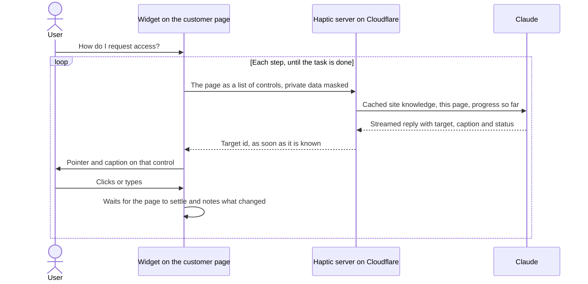

<div align="center">

<h1>
  <picture>
    <source media="(prefers-color-scheme: dark)" srcset="assets/logo-dark.svg">
    
  </picture>
</h1>

**The AI guide that lives in your product.**<br>
People say what they want to do, and Haptic points to exactly where to click, step by step.

[Live site](https://joinhaptic.com) · [How it works](#how-it-works) · [Engineering](#engineering) · [Benchmark](#benchmark) · [Docs](#documentation)

[](https://github.com/dartmouth-cs52/project-other-idea/actions/workflows/ci.yml)
[](https://joinhaptic.com)


</div>

<br>


<p align="center"><sub>A real, unscripted run on <a href="https://joinhaptic.com">joinhaptic.com</a> with the production model. The visitor asks one question, and Haptic leads them across a page load and through a form. To try it, click <b>Ask</b> on any page of the site.</sub></p>

## Overview

When someone gets stuck in a web app, the help on offer either sends them somewhere else or doesn't know what their screen looks like today.

| | On the user's screen | Follows the current UI | Points to the exact control |
|---|:---:|:---:|:---:|
| Help center articles | ✗ | ✗ | ✗ |
| Support chatbots | ✓ | ✗ | ✗ |
| Scripted product tours | ✓ | ✗ | ✓ |
| **Haptic** | ✓ | ✓ | ✓ |

A company installs Haptic with one script tag. It reads the page on every step, so it follows whatever the product looks like today. It learns the product from what the company already has, which is the site itself, its help docs and a few notes. Nobody authors a tour or maintains a selector.

## At a glance

| Claim | Evidence |
|---|---|
| **Accurate** | Points at the right control on 97% of steps on Haptic's own sites, 85% on twelve real apps, and 86% on three apps held out of all tuning. [Method, results for each app and caveats.](eval/README.md#results) |
| **Fast** | Replies are streamed, so the pointer moves as soon as the model names the control, about 0.8 s into a step. |
| **Small** | One script, 57 KB gzipped, with no dependencies, isolated in a shadow root. The code for Do it with me and for teach mode loads only where it is used. |
| **Safe on pages it has never seen** | Put into 107 public websites, it mounted on all 90 that could be tested and disturbed none of them while idle. It threw no errors, moved no elements and left the focus order as it was. [The same run lists what it still gets wrong.](eval/README.md#does-the-tag-work-on-any-website) |
| **Private by construction** | What a user types is never sent. Email addresses and long numbers are masked in the browser, and again on the server before anything is stored. [Exactly what, and the exceptions.](docs/privacy.md) |
| **Tested** | 77 test files, about 21,000 lines of tests for about 21,000 lines of widget and server code, including red-team pages and browser suites in Chromium, Firefox and WebKit. |
| **In production** | The widget server runs on Cloudflare Workers with Postgres on Neon, deployed from `main` by GitHub Actions, behind an invite-only dashboard at [joinhaptic.com](https://joinhaptic.com). |

## How it works



1. **Snapshot.** The widget lists every interactive control on the page with a short id, its role, label, state and position, such as `nav` or `main › Billing`. When a dialog is open, only the dialog is listed.
2. **Decide.** The server sends the snapshot, the goal and the progress so far to Claude. The site's knowledge is a cached prompt, so each step pays full price only for what changed. The reply has a strict schema, and a target that isn't on the page is dropped, so Haptic can only point at what the user can see.
3. **Point.** The pointer moves the moment the target id arrives, before the caption has finished streaming.
4. **Observe.** Once the user acts, the widget waits for the page to settle and reports what changed. If they click something else, Haptic notices and gives them the step that gets them back.
5. **Carry on.** Guide state lives in `sessionStorage`, so a guide continues across full page loads.

### What Haptic knows about a site

A crawl turns the site into a **graph**. Each page's title, headings, buttons and field labels make a node, and the links between pages are the edges. The dashboard's reader uses a headless browser and also opens each menu, tab and accordion, so the map knows which control a link sits behind. Real visits fill in what a crawl can't reach. The widget reports the labels on each page it loads on, and a label joins the map once three different visitors have seen it. [How visits teach it.](docs/widget.md#learning-the-site-from-visits) Together with the company's notes and help docs, this gives the model a map it can plan routes through, to pages the user hasn't reached yet.

## Engineering

The pointer is the easy part. Most of the code is what makes it safe to put in front of someone else's customers.

| Problem | How Haptic handles it |
|---|---|
| **A model that points at something that isn't there** | The model never returns coordinates or selectors, only the id of a control from the snapshot it was sent. The reply is checked against a strict schema, and a target that isn't on the page is dropped. |
| **Pages that try to give the model orders** | Page content is fenced off in the prompt as untrusted data, and every outgoing sentence passes rules on the server that drop links, contact details, payment details and requests for secrets. In the benchmark's hostile cases, text planted on the page was followed 0 times in 10. |
| **Private data on the page** | The widget sends labels, never field values, and leaves what a user typed out of every heading, label and option that repeats it. Email addresses, long numbers and phone and card numbers are masked in the browser and again on the server, by the same function. See [what is masked](docs/privacy.md) and [what is stored](docs/operations.md#what-is-recorded-about-visitors). |
| **An unbounded model bill** | Each site's knowledge is prompt-cached. Each site has hourly and daily dollar budgets, enforced on every step by reserving the step's maximum cost up front and settling to the real cost afterwards. Optional limits for each visitor count against a daily-salted hash of their address. A kill switch takes Haptic off one site, or all of them, without a deploy. See [spend limits](docs/operations.md#what-a-site-can-spend). |
| **Knowing whether a change made it better** | A [benchmark](eval/README.md) of 565 frozen steps with known right answers, scored for accuracy, latency and output hygiene, plus whole guides run start to finish in a browser. A staging copy of the server measures a prompt change against the real model before visitors get it. |
| **Real apps are harder than demos** | [Northpine](testbed/README.md) is a fake spend-management app with about 60 routes and 10,000 transactions. It is built to contain every UI pattern known to break a pointing guide, among them virtualized tables, portals, nested dialogs and command palettes. It comes with 179 tasks. |
| **Billing people can check** | Pricing charges only for finished guides. Finished has one definition shared by the widget, the database and the dashboard, which lists every billable guide with a download. |

### Beyond pointing

- **[Answers](docs/answers.md).** On a site with help docs, Haptic answers questions about what something does in words, citing the articles it drew on. The server, not the prompt, enforces the rules that matter. An answer must cite a real article. Prices, refunds and legal matters are never stated. A button an article names is checked against the page, so out-of-date docs get flagged instead of repeated.
- **[Do it with me](docs/widget.md#do-it-with-me).** Off unless a site turns it on. Haptic clicks, types and chooses on the page while the user watches, then points at the last control, the one that saves, sends or pays, for the user to click. It never types passwords or payment details, types only what the user wrote in their question, and stops on Escape. The server checks every action with the same rules as the widget.
- **[What people can't find](docs/corrections.md#what-people-cant-find-and-guide-health).** The dashboard leads with the questions people gave up on, and flags a common question whose guides stopped finishing, which is what a change to the product looks like.
- **[Teach Haptic](docs/corrections.md#teach-haptic).** When Haptic gets a question wrong, someone at the company presses Teach Haptic the right way in the dashboard. Their app opens with a one-time link, and they do the task once while the widget records which controls they use, never what they type. They review the steps, and from then on a question for the same task, the same action on the same thing, is guided along that route. The model still checks each step against the live page.
- **[Corrections](docs/corrections.md#point-here-instead).** When Haptic points at the wrong thing, the company picks the right control in the dashboard and the fix applies to similar questions from then on. A company can also list controls Haptic must never point at.
- **[Hand-off to a person](docs/answers.md#the-way-to-a-person).** When Haptic can't help, it passes the conversation to the company's existing support through a webhook, a contact page, email or the site's own chat widget. The webhook can be HMAC-signed.

## Benchmark

565 frozen single steps with known right answers, 448 of them on twelve real apps, and whole guides run start to finish in a browser. Measured against the production server with Claude Sonnet 5.5, every case run once. [Full results and caveats.](eval/README.md#results)

| Where | Single steps right | Whole guides that got there |
|---|---|---|
| Haptic's own demo app | 56 of 56 | 13 of 13 |
| joinhaptic.com | 15 of 17 | 4 of 5 |
| Hostile, off-topic, risky and badly asked questions on the demo app | 39 of 44, 89% | 3 of 3 |
| Nine real apps, among them SAP UI5, Ant Design Pro, OrangeHRM, Grafana and Jira | 299 of 352, 85% | 45 of 85, 53% |
| Three apps held out of all tuning, EspoCRM, GitLab and Moodle | 83 of 96, 86% | 21 of 29, 72% |

The gap between single steps and whole guides on real apps is the finding. About half the guides that did not get there were lost to the widget before the model had a fair chance, to an empty page, a pick it never heard, or two unnamed fields taken for one. That gap is the work in progress.

The production model was chosen earlier, from one run of the first 74 cases.

| Model | Right control | Plausible range | Time to pointer | Typical full step |
|---|---|---|---|---|
| Claude Sonnet, in production | 73 of 74 | 93 to 100% | 831 ms | 1449 ms |
| Claude Haiku | 73 of 74 | 93 to 100% | 949 ms | 1078 ms |
| Claude Opus | 72 of 74 | 91 to 99% | 1318 ms | 1720 ms |

Sonnet matches the best accuracy, names the control about half a second sooner than Opus, and costs about half as much per step. The ranges overlap, so the next step is more cases, especially from apps behind a login.

## Repository

| Path | What it is |
|---|---|
| [`src/widget`](src/widget) | The embeddable script, with the page snapshot, guide loop, pointer and panel |
| [`src/server`](src/server) | One request handler, `app.ts`, shared by the local Node server and the production Worker. It does validation, prompts, model calls, rules, budgets and recording |
| [`src/intake`](src/intake) | A CLI that crawls a site and its help docs, publishes it, and switches it on or off |
| [`worker`](worker) | The Cloudflare Worker entry point for `widget.joinhaptic.com` |
| [`web`](web) | [joinhaptic.com](https://joinhaptic.com) and the customer dashboard |
| [`db/migrations`](db/migrations) | Postgres schema for sites, guides and steps |
| [`eval`](eval) | The guide and Answers benchmarks, and the any-website sweep |
| [`test`](test) | Unit tests, browser tests and the red-team pages |
| [`testbed`](testbed) | Northpine, the stress-test app |
| [`demo`](demo) | A small multi-page app for trying the widget locally |
| [`DESIGN.md`](DESIGN.md) | The design system shared by the widget and the website |

**Stack.** TypeScript, Claude through the Anthropic SDK, Cloudflare Workers with KV and Durable Objects, Neon Postgres and Neon Auth, Next.js, Tailwind CSS and shadcn/ui, React and Vite, Resend, esbuild, Playwright, `node:test` and GitHub Actions.

## Quick start

Requires Node 20.19+ or 22.9+. CI uses Node 22.

```bash
npm install
cp .env.example .env   # add ANTHROPIC_API_KEY, or set HAPTIC_MODEL=mock to run without one
npm run dev            # http://localhost:4000, with a demo app at /demo/
```

In a second terminal, teach Haptic the demo app.

```bash
npm run tag -- --url http://localhost:4000/demo/ --id site_demo --name "Acme Console" \
  --notes demo/notes.md --docs demo/help
```

Open http://localhost:4000/demo/, click **Ask**, and try *how do I change my billing info*. Billing sits behind the account menu, so Haptic has to open that first. With `HAPTIC_MODEL=mock`, a keyword matcher stands in for the model, which is only good for testing the plumbing.

To build a context for any site, run `npm run tag -- --url https://app.example.com --name Example --notes notes.md --docs help/`. It prints the script tag to paste before `</body>`, and `npm run tag -- --help` lists every option.

## Development

```bash
npm test                          # unit tests (node:test)
npm run typecheck                 # tsc, strict
npm run build                     # bundle the widget to dist/widget.js, and the code that acts to dist/widget-act.js
npm run eval -- --models mock     # the guide benchmark, no API key needed
npm run eval:guides -- demo       # whole guides in a browser (needs the local server running)
npm run test:browser              # page reading in Chromium, and the widget in Chromium, Firefox and WebKit
npm run test:dashboard            # the built dashboard in Chromium, kept current from a real Postgres (see below)
npm run test:widget               # guides, hearing, Do it with me, the gate and red-team pages, in Chromium
```

The browser tests need Playwright's browsers once, with `npx playwright install chromium firefox webkit`. The act tests on pages built from the real React, Radix and cmdk also need those libraries for the run, and are skipped without them. Install them with `npm install --no-save react@19 react-dom@19 radix-ui@1 cmdk@1`.

The dashboard tests open the pages `next build` writes, so build the site first. They read every number from a local Postgres through the Worker's own queries, so they need `TEST_DATABASE_URL` set to an empty local database, never a real one. Run them with `cd web && npm run build && cd .. && TEST_DATABASE_URL=postgres://postgres@127.0.0.1:55432/haptic_test npm run test:dashboard`. A test writes a question and its steps to the database as the widget server does, and waits for the open page to show them by itself. Without the build or the database they are skipped, and say which is missing. `dashboard-tests.yml` runs them on every pull request that touches the dashboard.

`web/` and `testbed/` are separate packages with their own `npm run dev` and `npm run build`. On every push and pull request, CI typechecks, tests and builds the server, lints, tests and builds the website, and builds Northpine. A pull request that touches the widget also runs both browser suites, in `widget-tests.yml`. Pushes to `main` deploy the website and the widget server. The widget's deploy first runs the page-reading and widget browser tests and the acting-safety suites, which are the gate and the red-team pages. A [staging copy of the server](docs/operations.md#the-staging-server), with a small budget of its own, is for trying a change against the real model before visitors get it.

## Documentation

| Doc | Covers |
|---|---|
| [Operations](docs/operations.md) | Deploying, the database, what is recorded about visitors, what Teach Haptic keeps, billing outcomes, the kill switch, spend limits and step costs |
| [Privacy](docs/privacy.md) | What leaves the browser, what is masked first, and the exceptions |
| [The widget on a page](docs/widget.md) | Modal dialogs, covered controls, route changes, Do it with me, teach mode, learning the site from visits, and the browser tests |
| [Correcting Haptic](docs/corrections.md) | What people can't find, guide health and its emails, Point here instead, Teach Haptic, and controls Haptic must never point at |
| [Answers and hand-off](docs/answers.md) | Answering from help docs, the server-side rules, and hand-off to a person |
| [Benchmark](eval/README.md) | How cases work, how to run them, and results |
| [Website and dashboard](web/README.md) | Sign-in, approvals, the dashboard, and deploying the site |
| [Northpine](testbed/README.md) | The stress-test app and its tasks |
| [Design system](DESIGN.md) | Colour, type, radii and motion |

## Status

Haptic is in early access. It is running, by invitation, and free until billing starts. These are its known limits.

- On real apps a single step is right about 85% of the time, and about half the whole guides get there. On Haptic's own sites it is 97% and nearly all of them.
- The command-line crawler reads server-rendered HTML, so pages drawn by JavaScript or behind a login come back thin. The widget still reads every page as the user sees it, so those sites lean more on notes and docs.
- Nothing inside a rich-text editor, a canvas or a frame from another origin can be pointed at. For editors this is deliberate, because the widget reads nothing inside an area the user writes in.
- Answers has been run against a real model on one app, Northpine. Its own benchmark of 220 questions, 100 of them attacks, is built and has not yet been run against a real model.
- Do it with me is off by default. It does not pick dates yet, so a date field is handed to the user.

## How it was built

Haptic is written with [Claude Code](https://claude.com/claude-code), and the commit history shows it. Most commits are authored by the agent. The team's work is what the agent is pointed at and what it is held to. We decide what to build, and we set the bar a change has to clear before it merges. That bar is the frozen benchmark, the red-team pages, the browser suites, and a staging server for measuring a change to the prompt against the real model before visitors get it. A large share of this repository is that bar and not the product, namely the benchmark, Northpine, the any-website sweep and about as many lines of tests as of code under test.

## Team

Haptic started in Dartmouth's CS 52, Full-Stack Web Development. It's built by three people.

- **Charlie Peers**, [@charliepeers](https://github.com/charliepeers). The production server and its deployment, the benchmark, cost controls, Answers and hand-off, Do it with me, privacy masking, sign-in, the dashboard and onboarding flow, and joinhaptic.com.
- **Theodore Chan**, [@TheoC26](https://github.com/TheoC26). Northpine, how the widget follows a page through dialogs, covered controls and route changes, learning a site from visits, corrections and guide health.
- **Isaac Saxonov**, [@clewner](https://github.com/clewner). The first version of the widget, server and site crawler that the rest grew from, and mapping pages behind a sign-in.

## Licence

All rights reserved. The code is public so that it can be read, and the [LICENSE](LICENSE) allows nothing more without permission.
