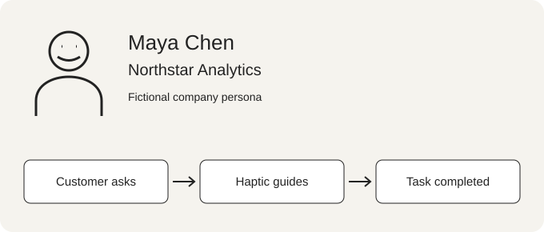

# Northstar Analytics: helping customers finish unfamiliar tasks

## Background and demographic information

* Fictional company: Northstar Analytics, a 45-person software company that sells reporting dashboards to small businesses.
* Fictional name: Maya Chen, 32, head of customer support.
* Demographics: Maya manages three support specialists. Her customers include business owners who use the dashboard only a few times a month.
* Overheard quote: "We answered 'where do I export this?' six times yesterday. The button is there. People just can't find it."

## Narrative

Northstar's dashboard has grown to include reports, integrations, billing, and team settings. Its help articles describe the right steps, but customers still struggle to match the instructions to their screens. Maya wants an assistant that helps inside the product and stays useful when menus move. She needs evidence that customers finish their tasks, not just that they open a chat.

## Behavioral and dimensional information

* Goals and motivations: Help customers complete routine tasks without waiting for support. Give her team more time for problems that need a person.
* Tasks: Install Haptic with a developer, add product guidance, review unanswered questions, and identify confusing parts of the dashboard.
* Pain points, concerns, and challenges: Product tours go stale. Customers lose their place when switching between documentation and the app. Incorrect guidance could make support work harder.
* User flow:
  1. Maya registers Northstar's site, and a developer adds Haptic's installation snippet.
  2. Maya adds approved product notes and tests a few common questions.
  3. A customer asks, "How do I export last month's report?"
  4. Haptic guides the customer through the relevant menus, waiting for each action.
  5. The customer downloads the report. If guidance fails, they can reach support.
  6. Maya reviews recurring questions and unsuccessful guides to decide what needs better instructions or a product change.
