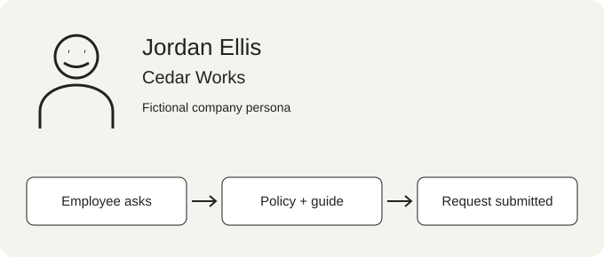

# Cedar Works: answering employee questions in the company portal

## Background and demographic information

* Fictional company: Cedar Works, a 220-person consulting company with a custom employee portal.
* Fictional name: Jordan Ellis, 38, people operations manager.
* Demographics: Jordan supports a distributed workforce with a two-person HR team. Employees use the portal for leave requests, onboarding, and company policies.
* Overheard quote: "People ask us what the policy says, then ask where to go to actually do it."

## Narrative

Jordan receives the same questions through email and team messages every week. The answers are spread across a handbook and the employee portal. Cedar wants Haptic to answer from approved company information and then show employees how to complete the related task. Jordan needs to update that information and keep sensitive material out of the assistant.

## Behavioral and dimensional information

* Goals and motivations: Help employees find reliable answers without waiting for HR. Spend less time repeating instructions.
* Tasks: Add and maintain approved policies, identify the right HR contact, and help employees navigate common portal workflows.
* Pain points, concerns, and challenges: Old policies remain in circulation. Employees may mistake an AI answer for an official decision. Private employee records must not become shared knowledge.
* User flow:
  1. Cedar's developer installs Haptic in the company portal.
  2. Jordan adds the current leave policy and its source, then checks a sample answer.
  3. An employee asks, "What is our leave request process?"
  4. Haptic explains the published process and links to the policy it used.
  5. The employee asks to submit a request, and Haptic points through the portal while the employee enters their own information.
  6. Questions about exceptions or personal eligibility go to HR. Haptic does not approve the request.
