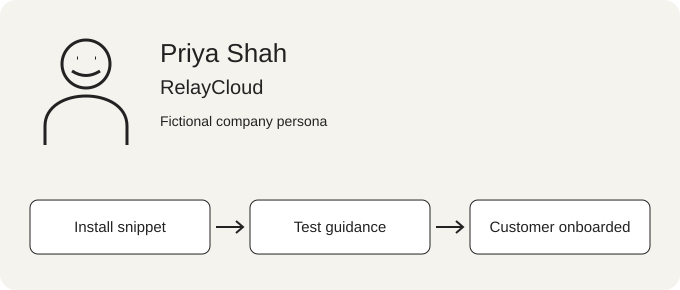

# RelayCloud: installing help without maintaining product tours

## Background and demographic information

* Fictional company: RelayCloud, an 18-person developer platform with a complex administration console.
* Fictional name: Priya Shah, 29, product engineer.
* Demographics: Priya shares responsibility for onboarding and support with a small engineering team. The console changes every week.
* Overheard quote: "I can add a script. I can't rebuild a guided tour every time we ship."

## Narrative

RelayCloud's customers need to create projects, invite teammates, and configure access before they can use the service. Priya wants help that works with the page in front of the customer rather than a fixed sequence of screens. She will try Haptic if installation is small, the assistant fits the product, and she can control what it learns.

## Behavioral and dimensional information

* Goals and motivations: Get customers through setup with little ongoing engineering work. Keep the existing console responsive and usable.
* Tasks: Register a site, configure allowed domains, install and test the snippet, adjust appearance, and inspect learned navigation.
* Pain points, concerns, and challenges: Setup flows cross pages and dialogs. Tours break when buttons move. An assistant that interferes with forms or exposes account data is unacceptable.
* User flow:
  1. Priya creates a Haptic account and registers RelayCloud's console.
  2. She configures allowed domains, copies the snippet, and verifies installation.
  3. She chooses an accent color, adds product notes, and reviews learned page labels.
  4. A new customer asks, "Help me create my first project."
  5. Haptic guides them through the setup wizard and continues as the page changes.
  6. After a console update, Priya checks that guidance still finds the relevant controls without rewriting a tour.
