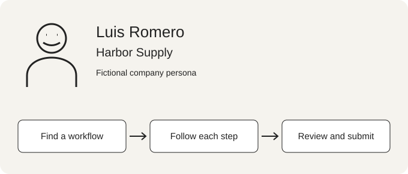

# Harbor Supply: helping occasional users work independently

## Background and demographic information

* Fictional company: Harbor Supply, a 90-person distributor with an internal purchasing and inventory portal.
* Fictional name: Luis Romero, 46, operations coordinator.
* Demographics: Luis uses the portal several times a week but handles unusual purchasing tasks only once or twice a quarter. He often enlarges text and navigates by keyboard.
* Overheard quote: "I did this three months ago. I shouldn't need someone to walk me through it again."

## Narrative

Harbor's operations director wants fewer interruptions for routine portal questions. Luis wants to finish his work without remembering every menu or sitting through a full training session. He needs short instructions he can follow at his own pace. A moving pointer alone will not help if he cannot see the label or reach the control with his keyboard.

## Behavioral and dimensional information

* Goals and motivations: Complete unfamiliar tasks independently and understand what will happen before submitting a change.
* Tasks: Find the right workflow, ask follow-up questions, follow readable instructions, and stop or seek help when needed.
* Pain points, concerns, and challenges: Internal terminology is unfamiliar. Long tutorials slow him down. Visual-only guidance excludes some coworkers, and a wrong instruction could change an order.
* User flow:
  1. Harbor installs Haptic in its portal and supplies approved purchasing instructions.
  2. Luis opens the assistant using the keyboard and asks how to request a new supplier.
  3. Haptic names the next control in text and highlights it on the page.
  4. Luis asks what a purchasing term means, then continues the guide.
  5. He reviews the request and submits it himself, or stops the guide at any point.
  6. If the workflow is unavailable to his account, Haptic explains its limits and offers the designated support contact.
