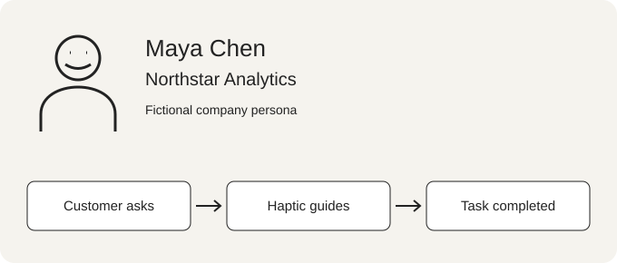
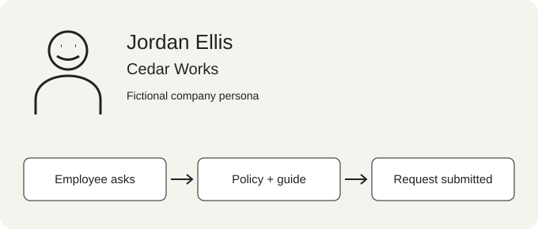
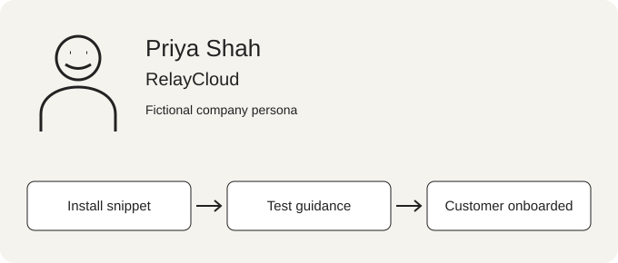
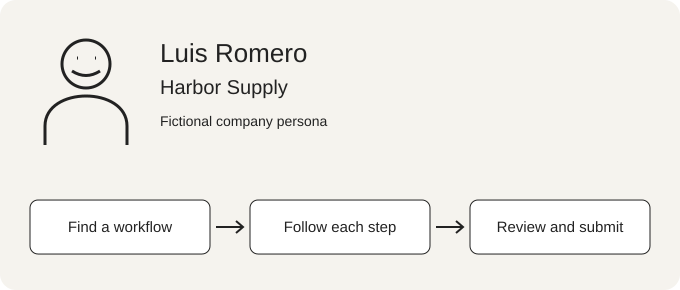

# Haptic feature spec

Draft for the CS 52 team. Each numbered section below is a separate proposed issue comment. All personas are fictional.

---

## Comment 1

# Northstar Analytics: helping customers finish unfamiliar tasks

## Background and demographic information

* Fictional company: Northstar Analytics, a 45-person software company that sells reporting dashboards to small businesses.
* Fictional name: Maya Chen, 32, head of customer support.
* Demographics: Maya manages three support specialists. Her customers include business owners who use the dashboard only a few times a month.
* Overheard quote: "We answered 'where do I export this?' six times yesterday. The button is there. People just can't find it."

## Narrative

Northstar's dashboard has grown to include reports, integrations, billing, and team settings. Its help articles describe the right steps, but customers still struggle to match the instructions to their screens. Maya wants an assistant that helps inside the product and stays useful when menus move. She needs evidence that customers finish their tasks, not just that they open a chat.

## Behavioral and dimensional information

* Goals and motivations: Help customers complete routine tasks without waiting for support. Give her team more time for problems that need a person.
* Tasks: Install Haptic with a developer, add product guidance, review unanswered questions, and identify confusing parts of the dashboard.
* Pain points, concerns, and challenges: Product tours go stale. Customers lose their place when switching between documentation and the app. Incorrect guidance could make support work harder.
* User flow:
  1. Maya registers Northstar's site, and a developer adds Haptic's installation snippet.
  2. Maya adds approved product notes and tests a few common questions.
  3. A customer asks, "How do I export last month's report?"
  4. Haptic guides the customer through the relevant menus, waiting for each action.
  5. The customer downloads the report. If guidance fails, they can reach support.
  6. Maya reviews recurring questions and unsuccessful guides to decide what needs better instructions or a product change.

---

## Comment 2

# Cedar Works: answering employee questions in the company portal

## Background and demographic information

* Fictional company: Cedar Works, a 220-person consulting company with a custom employee portal.
* Fictional name: Jordan Ellis, 38, people operations manager.
* Demographics: Jordan supports a distributed workforce with a two-person HR team. Employees use the portal for leave requests, onboarding, and company policies.
* Overheard quote: "People ask us what the policy says, then ask where to go to actually do it."

## Narrative

Jordan receives the same questions through email and team messages every week. The answers are spread across a handbook and the employee portal. Cedar wants Haptic to answer from approved company information and then show employees how to complete the related task. Jordan needs to update that information and keep sensitive material out of the assistant.

## Behavioral and dimensional information

* Goals and motivations: Help employees find reliable answers without waiting for HR. Spend less time repeating instructions.
* Tasks: Add and maintain approved policies, identify the right HR contact, and help employees navigate common portal workflows.
* Pain points, concerns, and challenges: Old policies remain in circulation. Employees may mistake an AI answer for an official decision. Private employee records must not become shared knowledge.
* User flow:
  1. Cedar's developer installs Haptic in the company portal.
  2. Jordan adds the current leave policy and its source, then checks a sample answer.
  3. An employee asks, "What is our leave request process?"
  4. Haptic explains the published process and links to the policy it used.
  5. The employee asks to submit a request, and Haptic points through the portal while the employee enters their own information.
  6. Questions about exceptions or personal eligibility go to HR. Haptic does not approve the request.

---

## Comment 3

# RelayCloud: installing help without maintaining product tours

## Background and demographic information

* Fictional company: RelayCloud, an 18-person developer platform with a complex administration console.
* Fictional name: Priya Shah, 29, product engineer.
* Demographics: Priya shares responsibility for onboarding and support with a small engineering team. The console changes every week.
* Overheard quote: "I can add a script. I can't rebuild a guided tour every time we ship."

## Narrative

RelayCloud's customers need to create projects, invite teammates, and configure access before they can use the service. Priya wants help that works with the page in front of the customer rather than a fixed sequence of screens. She will try Haptic if installation is small, the assistant fits the product, and she can control what it learns.

## Behavioral and dimensional information

* Goals and motivations: Get customers through setup with little ongoing engineering work. Keep the existing console responsive and usable.
* Tasks: Register a site, configure allowed domains, install and test the snippet, adjust appearance, and inspect learned navigation.
* Pain points, concerns, and challenges: Setup flows cross pages and dialogs. Tours break when buttons move. An assistant that interferes with forms or exposes account data is unacceptable.
* User flow:
  1. Priya creates a Haptic account and registers RelayCloud's console.
  2. She configures allowed domains, copies the snippet, and verifies installation.
  3. She chooses an accent color, adds product notes, and reviews learned page labels.
  4. A new customer asks, "Help me create my first project."
  5. Haptic guides them through the setup wizard and continues as the page changes.
  6. After a console update, Priya checks that guidance still finds the relevant controls without rewriting a tour.

---

## Comment 4

# Harbor Supply: helping occasional users work independently

## Background and demographic information

* Fictional company: Harbor Supply, a 90-person distributor with an internal purchasing and inventory portal.
* Fictional name: Luis Romero, 46, operations coordinator.
* Demographics: Luis uses the portal several times a week but handles unusual purchasing tasks only once or twice a quarter. He often enlarges text and navigates by keyboard.
* Overheard quote: "I did this three months ago. I shouldn't need someone to walk me through it again."

## Narrative

Harbor's operations director wants fewer interruptions for routine portal questions. Luis wants to finish his work without remembering every menu or sitting through a full training session. He needs short instructions he can follow at his own pace. A moving pointer alone will not help if he cannot see the label or reach the control with his keyboard.

## Behavioral and dimensional information

* Goals and motivations: Complete unfamiliar tasks independently and understand what will happen before submitting a change.
* Tasks: Find the right workflow, ask follow-up questions, follow readable instructions, and stop or seek help when needed.
* Pain points, concerns, and challenges: Internal terminology is unfamiliar. Long tutorials slow him down. Visual-only guidance excludes some coworkers, and a wrong instruction could change an order.
* User flow:
  1. Harbor installs Haptic in its portal and supplies approved purchasing instructions.
  2. Luis opens the assistant using the keyboard and asks how to request a new supplier.
  3. Haptic names the next control in text and highlights it on the page.
  4. Luis asks what a purchasing term means, then continues the guide.
  5. He reviews the request and submits it himself, or stops the guide at any point.
  6. If the workflow is unavailable to his account, Haptic explains its limits and offers the designated support contact.

---

## Comment 5

# Feature Spec

Haptic is an assistant that companies add to their websites with a small installation snippet. Users ask questions in plain language, get answers about the company or product, and receive step-by-step guidance through the website. Companies use it to reduce repetitive support and HR questions while helping people complete tasks on their own.

A company administrator registers a site, installs Haptic, and supplies approved information. A customer or employee opens the assistant where they are already working. Haptic answers their question or points to the next action, follows their progress across pages, and stops when the task is complete or it cannot reliably continue.

The first release targets websites the customer can modify. A company using a third-party HR platform would need that platform to support installation.

## Feature list

### Primary features

* 🔥 In-page questions and guided tasks. Users ask how to do something, and Haptic points to the next control with a short written instruction. It waits for the user's action and follows tasks across menus, dialogs, and pages. Users can ask follow-up questions or stop at any time. Useful to all four companies, especially Northstar and Harbor.
* 🔥 Simple installation and site management. Administrators create an account, register a website, configure allowed domains, and install a snippet. They can check installation, choose basic appearance settings, and manage each site's information. Useful to RelayCloud and Northstar.
* 🔥 Company-specific answers. Administrators supply approved notes and FAQs so Haptic can explain company terminology and procedures alongside website guidance. It admits when the available information does not answer the question. Useful to Cedar and Harbor.
* 🔥 Guidance that follows the current website. Haptic uses visible controls and learned navigation to find the next step. Administrators can inspect learned information and exclude unwanted labels. If a task stalls or a control is unavailable, Haptic stops instead of repeating the same instruction. Useful to RelayCloud and Northstar.
* 🔥 User control and accessible help. Guidance includes written instructions, keyboard access, readable contrast, and reduced-motion support. Users perform consequential actions themselves. Haptic does not read form values, and administrators can disable site learning. Useful to Harbor and Cedar.

### Secondary features

* 💼 A maintained company knowledge library. Administrators add approved documents or help-center pages, replace outdated material, and remove sources. Answers link to the source used. Useful to Cedar and Northstar.
* 💼 A route to human help. Users can reach the company's designated support or HR contact when guidance is insufficient. They review any question or conversation summary before sharing it. Useful to Cedar, Harbor, and Northstar.
* 💼 Support insights and feedback. Administrators see common questions, user feedback, and where guides stop so they can improve documentation and confusing workflows. Reports focus on product problems rather than ranking employees. Useful to Maya at Northstar and Priya at RelayCloud.

### Stretch features

* 🏹 Permission-aware assistance. Companies connect roles and access rules so users receive only the information they are authorized to see. Useful to Cedar and RelayCloud.
* 🏹 Voice and multilingual help. Users can speak questions and receive guidance in supported languages, with typing always available. Useful to Harbor.
* 🏹 Actions with explicit approval. For selected supported tasks, Haptic prepares an action, shows exactly what will change, and asks the user to approve it before execution. Useful to Harbor and RelayCloud.

## Scope and priorities

The existing prototype provides installation, typed guidance, company notes, learned navigation, appearance settings, and basic activity reporting. The course project will refine and validate those flows, including accessibility, then expand the assistant's company knowledge. Document ingestion, source-linked answers, human handoff, richer insights, and the stretch features are planned work. Voice code exists but is currently disabled because recognition was not reliable enough.

For the first release, success means a user can complete a supported task from their own question, the company can install and configure help without authoring each tour, and Haptic stops honestly when it cannot help. We will prioritize those outcomes before adding autonomous actions.

---

## Comment 6

# Who could this hurt?

Our most important feature is step-by-step guidance inside a company's website. Incorrect instructions could lead users to change billing, permissions, or employee information, while guidance that relies only on a pointer could exclude people who use screen readers or keyboard navigation. We will pair visual cues with accessible written instructions, test keyboard and screen-reader use, keep consequential actions under the user's control, and stop when the assistant cannot identify a reliable next step. A tempting dark pattern would be to hide human support behind repeated attempts with the assistant to make ticket numbers look better. We will keep human help available and let users dismiss Haptic without pressure to continue.
